# AMERICAN EXPRESS COMPANY (NYSE: AXP)
### El banco que se disfraza de club, medido con su propio capital regulatorio

Reconstrucción completa desde fuente primaria (EDGAR, Reserva Federal, tribunales, Congreso), independiente de cualquier tesis previa de este archivo sobre AXP. Método de doce pasos, refundación de julio de 2026, Motor de Valoración v3.1 (26-ago-2026), candado A bicameral (diablo + ángel, sesión limpia). CIK 0000004962.

**Fecha: 29 de agosto de 2026 · Precio de marca: 333,31 USD (cierre 28-ago-2026, IBKR) · Posición viva: 6 acciones, coste medio 341,29 USD, 1,36% del NAV**

Documento de trabajo personal. No es asesoramiento de inversión. Toda cifra lleva etiqueta HECHO (fuente primaria fechada) / INFERENCIA (cálculo propio sobre HECHO) / SUPUESTO (asunción declarada).

---

## El veredicto en una página

**Si solo lees esto: American Express es uno de los mejores negocios que existen, y este documento no encuentra ni un solo motivo para pensar lo contrario — ni un knock-out, ni un competidor que ya la haya alcanzado, ni un tribunal que le haya quitado su mecanismo central. El problema es exclusivamente de precio, y es medible: incluso construyéndole a AXP el escenario más generoso que la evidencia permite defender, sin recurrir a ningún artificio, el valor se queda entre 50 y 80 dólares por debajo de los 333,31 que pide hoy el mercado.** Ese resultado no cambió entre la primera versión de este documento y esta — lo que cambió es que ahora se entiende por qué, con el negocio descompuesto en sus dos motores reales, y no adivinado con un solo número.

American Express es, en realidad, dos negocios fusionados en una acción: un motor de pagos (red + suscripción) que casi no necesita capital y que muestra signos reales, medibles, de que su rentabilidad se está erosionando; y un motor de crédito que sí consume capital regulatorio, pero cuya rentabilidad aislada —23% a 31% sobre su propio capital, según cómo se reparta el gasto compartido— ya es, hoy, más alta que la de cualquier banco de tarjetas comparable, sin necesidad de suponer que mejora. **La pregunta que decide esta tesis no es "¿es bueno el negocio?" — la respuesta, con 175 años de evidencia, es sí sin reservas. La pregunta es cuánto de esa calidad ya está pagada por adelantado en el precio de hoy.**

|  |  |
|---|---|
| **Rentabilidad del motor de crédito, aislado (ROCET1, LTM)** | **23,8% – 31,1%** |
| **Banda de valor SOTP, escenario central** | **165 – 217 USD** |
| **Banda de valor SOTP, escenario más generoso defendible** | **249 – 280 USD (todavía por debajo del precio)** |

La advertencia que hay que hacer con el mismo rigor: hace diez días, el 19 de agosto de 2026, AXP perdió una batalla procesal (no de fondo) en un litigio anti-steering, y el acuerdo Visa/Mastercard que redefine el punto de venta sigue solo con aprobación preliminar. **Pero también hay que decir, con el mismo rigor, lo que la primera versión de este documento subponderó:** un jurado federal ya juzgó el fondo de un reclamo casi idéntico en agosto de 2025 y falló a favor de AXP en prácticamente todo; y la ley que sonaba a la amenaza regulatoria más seria —la Credit Card Competition Act— **exime explícitamente, por su propio texto, a los emisores de circuito cerrado como AXP.** El cuadro legal es más equilibrado de lo que parecía, no más sombrío.

**Las cuatro cifras que hay que retener:**

| La cifra | Qué significa |
|---|---|
| **9,15%** | La tasa de descuento reconstruida con beta propia (CAPM puro, R²=0,41 sobre 60 meses de datos), más baja que la tasa plana que este archivo usaba antes de la recalibración del método |
| **249-280 USD** | El valor de AXP en el escenario más generoso que este documento puede construir sin inventar un supuesto — el crédito no se erosiona nada, y el negocio de pagos deja de encogerse por completo. Sigue por debajo del precio, pero por primera vez la distancia se mide en decenas de dólares, no en el doble |
| **$387 frente a $165-280** | El valor justo que estimó la tesis anterior (9-jul-2026, sistema hoy retirado, sin separar los dos motores) frente a la banda de esta reconstrucción — la diferencia se explica en §10, no es opinión |
| **9 de 9 inversores** | Ninguno de los nueve inversores del panel formal (§10) dice "comprar hoy sin condición" — pero tampoco ninguno dice que el negocio sea malo. Tres frenan solo en el precio |

---

## §1 · Ciento setenta y cinco años sobreviviendo al fraude ajeno, al exceso propio y a una tragedia nacional

Un negocio no se juzga por lo que dice de sí mismo en un trimestre bueno: se juzga por lo que hizo cuando no tuvo opción. American Express tiene un registro auditado de casi dos siglos con tres ataques existenciales distintos —uno externo, uno propio, uno ajeno a los dos— y ninguno logró romper la franquicia. Esa es la evidencia que hay que mirar antes de mirar el precio.

**El primer conflicto de la historia de Amex fue sobre qué tan rápido crecer — y volvería a repetirse ciento cuarenta años después, con una factura mucho mayor.** La compañía nació el 18 de marzo de 1850 como fusión de tres empresas de transporte expreso, bajo el liderazgo de Henry Wells y William Fargo. Dos años más tarde, esos mismos dos hombres fundarían Wells Fargo & Co. — pocos recuerdan que Wells Fargo nació como una escisión de Amex, no al revés: el cofundador John Butterfield se opuso a expandir operaciones hacia California, así que Wells y Fargo armaron una compañía aparte para cubrir esa ruta. [HECHO]

**El invento que la hizo global no fue el transporte ni la tarjeta.** En 1891, el presidente J. C. Fargo viajaba por Europa cuando descubrió que sus cartas de crédito tradicionales no servían fuera de las grandes ciudades. Volvió furioso y le encargó a un empleado, Marcellus Flemming Berry, "inventar algo mejor". Berry patentó el travelers cheque —instrumento prepagado y garantizado, precursor directo de la tarjeta de crédito moderna— el 7 de julio de 1891. El patrón se repite en toda la historia de la compañía: Amex no gana por ser primero en una categoría, gana por resolver el problema específico del viajero afluente mejor que nadie. [HECHO]

**El primer charge card** —tarjeta de cargo, sin línea de crédito revolvente, se paga el saldo completo cada mes— se lanzó el 1 de octubre de 1958, con 250.000 tarjetas ya emitidas antes del lanzamiento oficial por la demanda anticipada. La cuota anual se fijó en 6 dólares, un dólar más cara que Diners Club, su competencia de entonces, y deliberadamente así: la idea nunca fue competir en precio, sino posicionar el producto como algo premium desde el primer día. Los 895 dólares de la Platinum de 2026 no son una desviación de la estrategia original: son su continuación literal, sesenta y ocho años después. [HECHO]

**El primer gran ataque al modelo no vino de un competidor, sino de un fraude — y ahí aparece, por primera vez, Warren Buffett.** En 1963, un comerciante de aceite vegetal llamado Anthony "Tino" De Angelis usó tanques llenos mayormente de agua de mar con una fina capa de aceite flotando encima como colateral falso para pedir préstamos a 51 bancos, respaldados por certificados de depósito de una subsidiaria de Amex. Cuando el fraude —conocido como el "Salad Oil Scandal"— salió a la luz, la acción cayó de 61,81 a 40,00 USD entre el 20 de noviembre y el 2 de diciembre de 1963, y tocó fondo en 35,31 USD el 2 de junio de 1964: una caída de aproximadamente −43% en menos de ocho meses, la primera crisis existencial verificable de la compañía [HECHO, corroborado por prensa financiera contemporánea — Fortune, 2024; DEGRADADO porque ninguna fuente consultada cita un registro primario de cotización de época — se usa como color narrativo, no como ancla de ningún cálculo].

Mientras el mercado vendía en pánico, Buffett compró en silencio cerca del 5% de Amex por 20 millones de dólares —llegó a representar ~40% de la cartera de Buffett Partnership, su vehículo de inversión de entonces—. No pidió asiento en el directorio ni intentó cambiar la gerencia; en cambio, pidió que la compañía usara sus propios recursos para compensar a los defraudados, protegiendo la confianza de marca por encima del resultado trimestral. Dos años y medio después, la acción había subido 124% frente a −6% del Dow Jones. Buffett Partnership vendió esa posición en 1967 con una ganancia considerable — **no es la misma tenencia que existe hoy**. Casi treinta años después, ya al mando de Berkshire Hathaway, Buffett volvería a comprar AXP desde cero —esta vez para quedarse— construyendo entre 1991 y 1994 la posición del ~22% que Berkshire sostiene hasta hoy (ver §7). Es, en efecto, la misma convicción aplicada dos veces, treinta años y dos crisis distintas de por medio. [HECHO]

**El segundo gran ataque sí vino de adentro.** Bajo el CEO James D. Robinson III, Amex se diversificó agresivamente hacia banca de inversión y seguros, comprando Shearson/Lehman. En abril de 1990, Shearson Lehman reportó una pérdida trimestral de 915 millones de dólares —la mayor de Wall Street hasta ese momento— obligando a Amex a inyectar 1.000 millones para estabilizarla. Robinson renunció bajo presión del directorio en 1993 y admitió públicamente que su "mayor error de cálculo fue un enfoque en el crecimiento demasiado rápido". Es la misma tensión fundacional de 1852 —Amex quería crecer más rápido de lo prudente— repitiéndose 140 años después, con una factura mucho mayor. [HECHO]

**El tercer ataque fue una tragedia nacional, no un error propio.** El 11 de septiembre de 2001, la sede de Amex —en 200 Vesey Street, justo enfrente de las Torres Gemelas— sufrió daños graves y once empleados de la compañía murieron ese día, meses después de que Kenneth Chenault asumiera como CEO. Chenault reunió a todo el personal del área tri-estatal en el Madison Square Garden, condonó millones de dólares en cargos e intereses de tarjetas a clientes afectados, y la compañía no pudo regresar a su sede hasta mayo de 2002. Es el episodio que más se cita, dentro y fuera de la empresa, cuando se habla de liderazgo bajo presión en Amex — y sigue siendo, un cuarto de siglo después, la referencia interna que la cultura corporativa usa para medirse a sí misma. [HECHO]

### La crisis financiera de 2008-2009 — lo que se rompió y lo que no

El beneficio neto cayó de 4.012 M (2007) a 2.130 M (2009, −47%) y el ROE de 37,3% a 14,6% — pero **nunca hubo un trimestre de pérdidas** (HECHO, 10-K FY2008-2010, Exhibit 13). El valor contable por acción subió cada año de la crisis (8,76→13,56 USD, 2006-2010).

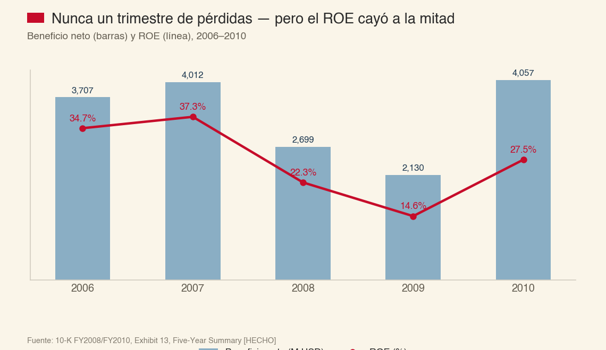

Y sin embargo la financiación sí se rompió: el 14 de noviembre de 2008 AXP se convirtió en *bank holding company* precisamente para poder acceder a los programas de la Reserva Federal; al cierre de 2008, el **61,6%** de su papel comercial (4.500 de 7.300 M USD) estaba colocado a través del CPFF de la Fed (HECHO, 10-K FY2008). El 9 de enero de 2009 recibió 3.388.890.000 USD del TARP —acciones preferentes al 5%/9% más un warrant a diez años— y lo devolvió en 159 días (17-jun-2009), a un coste total en efectivo de **414 M USD** (74 M de dividendos + 340 M de recompra del warrant, HECHO, 10-K FY2009). El SCAP de mayo de 2009 concluyó formalmente que AXP **no necesitaba capital adicional**: Tier 1 común de 9,7%, unos 6.000 M por encima del mínimo exigido. Como precondición para repagar tuvo que emitir 3.000 M de deuda senior sin garantía (mayo 2009, cupón medio 7,76%, contra 2,75% en 2010) y ampliar capital en ~22 millones de acciones a 25,25 USD. Los depósitos de clientes pasaron de ser el 13,7% de la financiación total (2008) al **29,9%** (2010) — el giro estructural hacia financiación minorista que define el balance de hoy.

### Costco, 2015: el experimento natural más limpio del expediente

El 12-feb-2015, antes de la apertura del mercado (comunicado aceptado en EDGAR a las 07:36 ET), AXP anunció que no renovaría el cobrand de Costco en EE. UU. Las cuentas representaban ~8% del billed business mundial, ~19-20% de los préstamos y ~10% de las tarjetas en circulación (HECHO, doble fuente: 10-K FY2014 y FY2015). La acción, que había cerrado en 86,01 USD el día anterior, cayó a 80,48 USD ese mismo día (−6,4%) y a 78,08 USD al día siguiente (−9,2% acumulado en dos sesiones, confirmado de forma independiente por Zacks) — y siguió cayendo durante el año siguiente hasta un mínimo de 51,11 USD el 11 de febrero de 2016, casi exactamente un año después del anuncio: −40,6% desde el cierre previo al anuncio (HECHO, precios de cierre nominales verificados contra los rangos trimestrales auditados del propio 10-K; una primera pasada de esta investigación usó por error precios ajustados retroactivamente por dividendos, que subestiman sistemáticamente las cotizaciones de 2015-2016 en ~15%, y fue corregida antes de esta redacción). La venta de la cartera se cerró en junio de 2016 con una ganancia pretax de 1.100 M USD.

**Y lo que pasó después es la prueba de foso más limpia que existe en el archivo de AXP: el gasto por tarjeta de los clientes que se quedaron subió, y aceleró — el comerciante no lo aprovechó.**

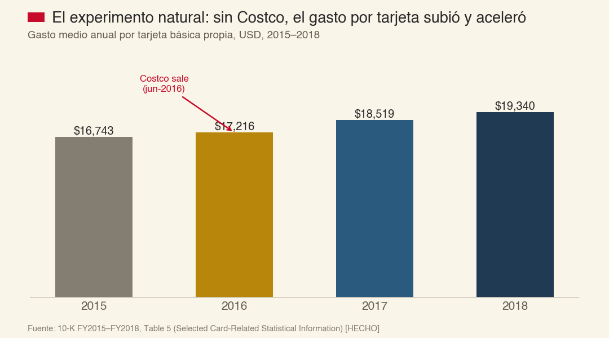

El +7,6% de 2017 no admite la explicación de "sin Costco pesando en la base", porque Costco ya llevaba un año fuera desde junio de 2016 — el gasto por tarjeta superviviente mejoró de forma genuina y medible. La tasa de descuento a comercios **no subió** — de hecho bajó ligeramente — porque ningún comerciante grande usó el precedente para renegociar. El foso sobrevivió el ataque. Lo que también muestra el experimento: la cartera prestada se reconstruyó por completo en dos años (+40%), y el margen antes de impuestos, que era 26,3% antes de Costco, no volvió a ese nivel — se instaló en el rango 17-20% donde vive hoy. **La lección: el foso se defendió, pero se defendió comprando al cliente, no gratis.**

### Ohio v. American Express Co., 585 U.S. ___ (2018) — el fallo que sostiene el mecanismo de precios

Decidido 5-4 (Thomas por la mayoría; disenso de Breyer), confirmado el 25 de junio de 2018 (HECHO, slip opinion oficial de la Corte Suprema, verificado contra el docket oficial): las cláusulas anti-steering de AXP —que prohíben al comercio recargar o desviar al cliente hacia otra tarjeta en el punto de venta— **no violan la ley antitrust federal**, porque el mercado de tarjetas debe analizarse como una plataforma de dos lados y los demandantes no probaron efecto anticompetitivo neto. Es el fallo que impide que el 2,24% de discount revenue se desarme por el eslabón más débil: sin anti-steering, el comercio recarga el coste o empuja al cliente hacia Visa, y toda la ecuación —descuento alto que financia recompensas que atraen al gasto alto— se rompe. **Este fallo, siete años después, vuelve a estar bajo ataque activo en tres frentes distintos — ver §5.**

### COVID-19: el test que AXP suspendió por ingresos y aprobó por crédito

En 2020 los ingresos cayeron 17% y el beneficio neto 54% (HECHO, 10-K FY2020). Y en el mismo periodo, la morosidad a 30+ días **bajó** de 1,5% (2019) a 1,0% (2020); los net write-offs realizados también bajaron. El propio 10-K atribuye la mejora a "niveles récord de estímulo gubernamental y la amplia disponibilidad de programas de indulgencia" — un descuento honesto que hay que aplicar. El aumento de provisiones (+32%) fue casi enteramente reserva prospectiva bajo CECL, no deterioro real observado. Y en el año en que sus salones VIP estaban cerrados, **los net card fees subieron 15%** — la cuota anual demostró ser estructuralmente inelástica al shock más severo imaginable, precisamente porque el titular no compra el uso del beneficio: compra la pertenencia.

### La era premium, 2021-2026 — y Capital One-Discover, el rival que no había existido desde 1985

Desde enero de 2022 AXP guía crecimiento anual explícito y lo ha cumplido o superado en ingresos 4 de 5 años, y en EPS todos los años salvo 2023 (dentro de rango, extremo bajo). La Platinum de consumo subió de 550 a 695 USD (jul-2021, +26%) y de 695 a 895 USD (18-sep-2025, +29%); la Gold, de 250 a 325 USD (jul-2024, +30%). Dato nuevo y no trivial: **desde el comunicado de enero de 2025, AXP dejó de repetir la cifra numérica exacta de su aspiración plurianual** ("ingresos +10%/EPS mid-teens") — cero apariciones en cuatro comunicados 8-K consecutivos (confirmado por búsqueda de texto completo sobre los cuatro documentos), sustituida por "growth aspiration" genérico sin número. No hay declaración de la empresa que explique el cambio; es una observación, no una acusación.

Y el 18 de mayo de 2025, Capital One cerró la compra de Discover Financial Services por 35.300 millones de dólares — creando, por primera vez desde que Discover se lanzó en 1985, un competidor con la misma estructura de red cerrada (emisor + adquirente + red a la vez) y el capital suficiente para intentar competir con ella a escala. **Un foso que nunca fue puesto a prueba no es lo mismo que un foso invulnerable: solo que hasta ahora nadie lo había intentado cruzar con el capital suficiente.** Es el tema central de §5.

---

## §2 · El modelo de negocio, explicado a fondo — y el banco que se esconde dentro de la red

### El problema que resuelve, en dos minutos

Imagine un restaurante en cualquier ciudad y un cliente que quiere pagar sin llevar efectivo. Entre los dos hacen falta, en la práctica, cuatro funciones que casi nadie distingue: **el emisor** (da la tarjeta, asume el riesgo de impago, decide los puntos — en el mundo Visa, esto es Chase o Citi); **el adquirente** (le pone el datáfono al comercio y le abona el dinero); **la red** (el conmutador que enruta el mensaje y fija las reglas — Visa y Mastercard, que no prestan dinero ni tienen clientes propios); y **el comercio y el titular**, que pagan por todo lo anterior.

**Visa y Mastercard son solo la tercera pieza.** Su propio 10-K lo dice sin rodeos: no reciben ingreso del interchange, que pasa del adquirente al emisor sin tocar su cuenta de resultados. American Express es las tres primeras piezas a la vez — emite, adquiere y enruta —, lo que la industria llama **modelo de tres partes** o **red cerrada (closed-loop)**, frente al **modelo de cuatro partes** de sus dos competidores. Es, en esencia, un peaje cobrado tres veces sobre el mismo tramo de camino —la comisión de tarjeta anual, la tasa de descuento al comercio, y el interés sobre el saldo financiado cuando el cliente no paga de contado— algo que solo es posible porque Amex es dueña del camino entero.

Esa arquitectura produce el dato de portada más citado sobre AXP: retiene el **2,24%** de cada dólar facturado con sus tarjetas (37.401 M USD de *discount revenue* sobre 1.669,8 mil M de *billed business*, FY2025, HECHO), contra el 0,2-0,3% de Visa y Mastercard. Nueve veces más. **Es el error de encuadre más caro de analizar mal esta empresa**, porque compara el ingreso *bruto* de un negocio con el ingreso *neto* de otro. La contabilidad interna de AXP separa el reparto: en sus tres segmentos emisores (USCS, CS, ICS) el *discount revenue* refleja el componente emisor; solo en GMNS (Global Merchant and Network Services) refleja el componente de red y adquirencia puro — la pieza que de verdad es comparable con Visa.

**GMNS, la red pura de AXP, en FY2025 (HECHO, Nota 23 y Tabla 14 del 10-K):**

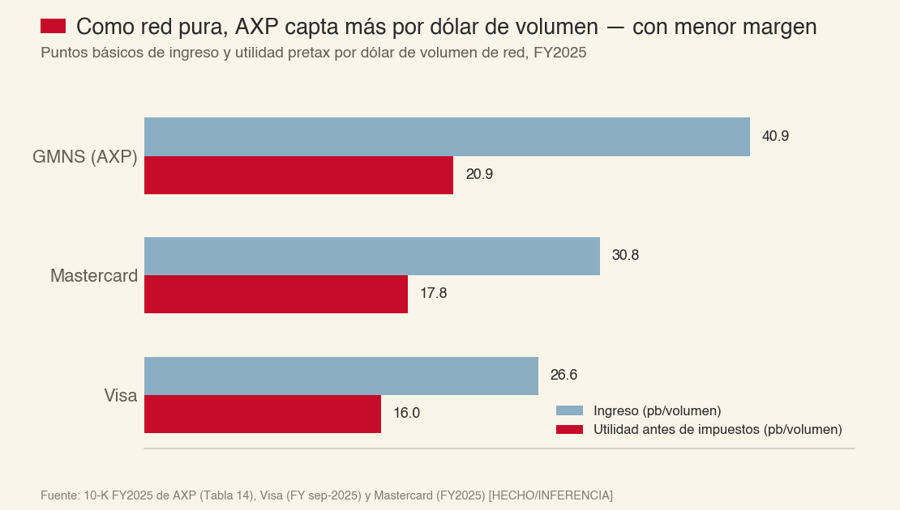

**Como red, AXP capta más ingreso por dólar de volumen que Visa y Mastercard, pero con un margen inferior.** La ventaja de red cerrada es real pero de segundo orden — no el "nueve por uno" que sugiere la comparación bruta. Lo que el 2,24% sí compra, y que Visa no tiene: un cliente que gasta varias veces más por tarjeta que la media del sistema. Con la definición más amplia (Nilson Report issue 1288, vía 10-K de Visa, CY2024 — el universo COMPLETO de tarjetas Amex en circulación en el mundo, propias y emitidas por bancos terceros bajo licencia de red, no solo la básica propia): 11.905 USD/año por tarjeta, contra 2.796 en Visa y 2.547 en Mastercard — 4,3x y 4,7x. Con la definición más estrecha y más limpia, que AXP sí reporta directamente para su tarjeta básica propia (*Average proprietary basic Card Member spending*, HECHO, Tabla 5 del 10-K FY2025): **25.453 USD/año en 2025** (24.608 en 2024) — más del doble de la cifra de Nilson, porque su denominador es 2,3 veces más estrecho. Ambas cifras son reales y verificables; miden universos distintos, y la más relevante para entender el foso es la segunda. Una suscripción anual que se cobra por adelantado y se devenga linealmente a doce meses (9.993 M USD de *net card fees* en FY2025, 13,8% de los ingresos), y —esto es lo que casi nadie conecta— el mismo cliente afluente que gasta también **le presta dinero a AXP**: los depósitos son hoy el 72,7% de toda la financiación (156.973 M USD, jun-2026, HECHO).

### El mapa de ingresos, y la deriva de una década

**FY2025 (HECHO, Estado de Resultados Consolidado):**

| Línea | 2025 (M USD) | % de ingresos |
|---|---|---|
| Discount revenue | 37.401 | 51,8% |
| Net interest income | 17.364 | 24,0% |
| Net card fees | 9.993 | 13,8% |
| Service fees & otros | 7.471 | 10,3% |
| **Total** | **72.229** | **100%** |

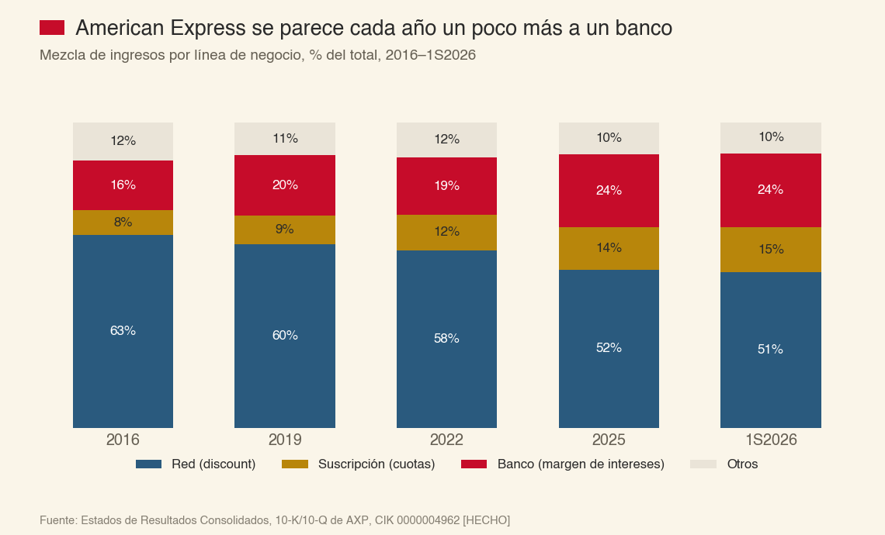

La deriva de una década, fresca hasta el segundo trimestre de 2026: la porción de red (*discount*) baja de 63,1% (2016) a 51,0% (1S2026); la de suscripción sube de 8,1% a 14,6%; y la de margen de intereses —el negocio de prestar— sube de 16,3% a 24,2%. **American Express se parece cada año un poco más a un banco de tarjetas y un poco menos a una red de pagos.** Esto no es una opinión: es la mezcla de ingresos que la propia empresa reporta, año sobre año, sin excepción en la serie.

### El banco escondido dentro de la red

Los cuatro segmentos operativos de AXP no se dividen entre "banco" y "red" — se dividen entre USCS, CS, ICS y GMNS, una geografía de cliente, no de mecanismo económico. Pero sus márgenes ya insinúan dónde vive el dinero:

**Márgenes antes de impuestos por segmento, FY2025 (HECHO, Nota 23):**

| Segmento | Ingresos (M) | Pretax (M) | Margen |
|---|---|---|---|
| **GMNS** (red/adquirencia) | 7.759 | 3.968 | **51,1%** |
| **CS** (Commercial Services) | 16.926 | 3.668 | 21,7% |
| **USCS** (U.S. Consumer) | 34.814 | 6.810 | 19,6% |
| **ICS** (International) | 13.000 | 1.603 | 12,3% |
| Corporate & Other | −270 | −2.254 | — |
| **Consolidado** | **72.229** | **13.795** | **19,1%** |

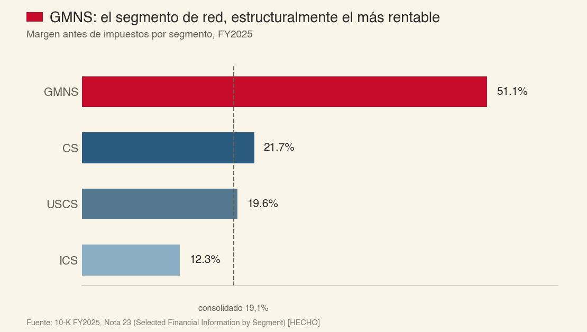

GMNS —la porción que de verdad es "Visa por dentro"— es estructuralmente el segmento más rentable, por un margen amplio, exactamente lo que se esperaría de un negocio de red *asset-light* frente a tres negocios que además prestan dinero, pagan recompensas y absorben riesgo de crédito. El 54,4% del beneficio combinado de los tres segmentos emisores no viene del comercio: viene, en última instancia, de la parte prestamista de cada uno de ellos — un dato que la propia AXP no permite aislar con precisión porque, como declara su MD&A, **no publica la separación entre su negocio prestamista y su negocio no prestamista** dentro de USCS/CS/ICS. Es la limitación más importante de todo este expediente y no depende de nosotros resolverla: sin ese reparto, ningún motor de valoración —el de esta tesis incluido— puede producir un valor intrínseco puntual. Solo una banda.

> **EN ROMÁN PALADINO**
> Piense en American Express como dos negocios cosidos en una sola acción: un peaje de red que cobra por cada transacción y casi no necesita capital (GMNS, margen 51%), y un banco de tarjetas de consumo afluente que sí necesita capital regulatorio para prestar (USCS+CS+ICS, margen 12-22%). El primero se parece a Visa. El segundo se parece a Capital One. Comprar la acción es comprar los dos a la vez, sin poder elegir solo el que más le gusta — y el que crece más rápido, año tras año, es el segundo.

**Lo que sí se puede medir con precisión es qué tan rápido crece el coste de mantener al cliente premium frente a lo que ese cliente paga.** El Variable Customer Expense (recompensas + desarrollo de negocio + servicios al titular) pasó de 41,3% de los ingresos (FY2023) a **44,7% en el primer semestre de 2026** (HECHO, MD&A). Es la partida que crece más rápido de todo el estado de resultados, cinco puntos en dos años y medio, exactamente el periodo en que AXP subió el precio del Platinum un 40% en tres etapas.

---

## §3 · TAM, SAM, SOM y el runway real

**El mercado total (TAM).** La cifra que más circula —52,39 billones de dólares (trillion) para 2026, atribuida a Nilson Report— es real (Nilson Report, Issue 1124, verificado directamente en nilsonreport.com), pero es una **proyección hecha en enero de 2018, con ocho años de antigüedad**, para las seis marcas globales incluyendo UnionPay. No hay evidencia de que Nilson la haya revalidado desde entonces. Un ancla más fresca y más trazable a fuente auditada: el propio 10-K FY2025 de Visa cita a Nilson (Issue 1288, junio 2025) para una tabla comparativa de **datos reales del año calendario 2024** entre cinco redes (sin UnionPay) — sumando su "Total Volume": Visa 15.927 + Amex 1.765 + Diners/Discover 266 + JCB 327 + Mastercard 9.757 = **≈28,04 billones de dólares** [INFERENCIA, cálculo propio sobre HECHO]. Es un concepto más amplio que "purchase volume" puro (incluye volumen en efectivo) y más estrecho que el TAM de seis marcas de 2018, pero es el número más reciente y mejor sustentado disponible en fuente primaria.

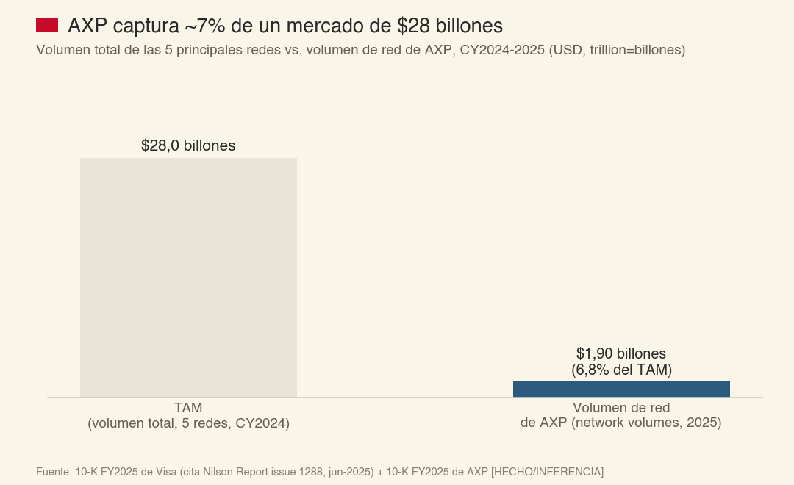

**El mercado servible (SAM) — lo que AXP ya captura.** El volumen de red de AXP (*network volumes*) fue de 1.897,0 mil millones USD en FY2025 — **~6,8% del TAM de 28 billones**, consistente con la tesis de que AXP compite en profundidad (economía por transacción) y no en amplitud (participación de mercado): es un cazador que elige presas grandes y pocas, no uno que persigue todo lo que se mueve.

**El mercado obtenible (SOM) — el núcleo afluente doméstico, y qué tan lleno está.** AXP cerró el segundo trimestre de 2026 con 155,1 millones de tarjetas en circulación en el mundo (87,6 millones propias; 152,8M/86,6M a cierre de FY2025, HECHO, Tabla 5 del 10-K/10-Q). El proxy doméstico más limpio es el segmento USCS (EE. UU., consumo): 48,3 millones de tarjetas propias a cierre de 2025 (HECHO, Tabla 9).

Del lado de la demanda, la cifra de "33 millones de adultos afluentes en EE. UU." que circula ampliamente —y que probablemente sea el origen de cálculos de saturación anteriores— **se rastrea a un comunicado de prensa de una firma privada (Spectrem Group) de 2006, no a un dato de la Reserva Federal**, y no debe tratarse como HECHO fresco. Dos alternativas verificables y actuales:

| Definición | Fuente | Universo (hogares EE. UU.) |
|---|---|---|
| "Mass affluent" (activos financieros 100K-1M USD) | Datos Insights, sobre la Survey of Consumer Finances 2022 de la Fed | ~28% de los hogares ≈ 36,7 millones (con el total de hogares 2022) |
| Ingreso ≥150.000 USD/año | US Census Bureau, *Income in the United States: 2024* (P60-286, sep-2025) | ~26,1% de 134,8M hogares ≈ 35,2 millones |
| Ingreso ≥200.000 USD/año | Mismo informe | ~16,0% ≈ 21,6 millones |

Ambas definiciones convergen, por caminos distintos, en un rango de **~22 a ~37 millones de hogares afluentes en EE. UU.** — no exactamente comparable con "tarjetas propias de USCS" (48,3 millones) porque una es una unidad de hogar y la otra de tarjeta/individuo, y porque un mismo Card Member suele tener más de una tarjeta Amex (Platinum personal + Gold + una de negocio). **AXP no publica el número de Card Members únicos**, así que un cálculo de "penetración" preciso no es posible con los datos disponibles — pero el orden de magnitud (48 millones de tarjetas propias domésticas contra 22-37 millones de hogares afluentes) sugiere que la base ya está **mayoritariamente capturada** en el núcleo doméstico tradicional, consistente con que el crecimiento reciente de nuevas cuentas dependa cada vez más de dos motores distintos al núcleo histórico: cohortes Millennial/Gen-Z que todavía no ganan en el rango afluente tradicional pero pagan la cuota por señalización de estatus, y el mercado internacional, donde ICS creció su base propia +16% interanual en el primer semestre de 2026 (HECHO) frente a un crecimiento de un dígito medio en EE. UU.

**Catalizadores 2026-2028, con la etiqueta de confianza correcta:**

1. **La venta de la participación en Global Business Travel (GBT) — pendiente, no cerrada** (ver §7 para el detalle: la operación se anunció en mayo de 2026, los accionistas de GBT la aprobaron el 3-ago-2026, pero a 29-ago-2026 sigue sujeta a aprobación regulatoria y GBT sigue cotizando de forma independiente). Si cierra, liberaría ~1.500 M USD en efectivo y ~975 M USD de ganancia pretax no reconocidos todavía en ningún estado financiero — un catalizador real pero **condicional**, no un hecho consumado como sugería el documento previo de referencia.
2. **La inflexión de margen de ICS** (International Card Services), de 9,0% a 12,3% de margen pretax en dos años, con el segmento acelerando a +16% de crecimiento de tarjetas propias — un motor de expansión de margen que el foco analítico centrado en EE. UU. tiende a subponderar.
3. **Resolución de los frentes legales/regulatorios de §4-5** en cualquier dirección — remueven incertidumbre, no necesariamente en la dirección que el mercado espera.

---

## §4 · El moat: mecanismo, capas y cuántos años dura

El foso de AXP tiene tres piezas estructurales y una posición, cada una con un reloj de duración distinto — y la pregunta que de verdad importa no es si el foso existe hoy, sino cuántos de esos relojes siguen corriendo a favor.

### Pieza 1 — la cuota prepagada, con coste hundido

Las cuotas se difieren y reconocen linealmente sobre doce meses (Nota 1, 10-K). Cada subida de precio refuerza el bloqueo: cuanto más alta la cuota, más caro salirse a mitad de año — es financiación efectivamente gratuita del ciclo operativo, cobrada antes de prestar el servicio. **Reloj: mientras AXP siga vendiendo suscripciones anuales prepagadas, esta pieza no se apaga por sí sola.** Lo que sí puede apagarla es que deje de ser rentable venderlas — ver el "Reloj 2" más abajo.

### Pieza 2 — el pasivo de puntos, como coste de cambio conductual

El programa Membership Rewards acumula un saldo de puntos que el titular pierde total o parcialmente si cambia de emisor — un coste de cambio (*switching cost*) clásico de cualquier programa de lealtad bien diseñado. Cuanto mayor el saldo acumulado, mayor la fricción de irse. Este mecanismo es estructural y no depende de ningún litigio ni de ninguna cifra trimestral: es contable, y dura mientras el programa exista.

### Pieza 3 — la sentencia Ohio v. Amex, puesta a prueba en tres frentes reales en los últimos quince meses — con un resultado más matizado de lo que parece a primera vista

Aquí está el hallazgo más trabajado de esta reconstrucción, y los tres frentes estaban en un estado distinto —y en algún caso mal entendido— la última vez que se miró esta empresa.

**Frente 1 — un jurado federal ya juzgó el fondo del argumento anti-steering, y AXP ganó casi todo.** *Moskowitz, et al. (antes Oliver) v. American Express Co.*, caso nacional presentado en 2019 ante el Distrito Este de Nueva York (Brooklyn) — no un tribunal de Illinois, como se creía inicialmente. Entre el 11 y el 28 de agosto de 2025, un jurado juzgó las reclamaciones de varias clases certificadas (débito en diez estados más DC; crédito sin recompensas en DC, Kansas e Illinois) alegando que las cláusulas de no discriminación de AXP violaban leyes antitrust/de protección al consumidor. **El veredicto: a favor de American Express en absolutamente todas las reclamaciones antimonopolio, para todas las clases** — la única excepción fue una reclamación bajo la ley de protección al consumidor de Illinois (no antitrust, no anti-steering en sentido estricto), con 12,5 millones de dólares en daños. AXP y los demandantes acordaron después un pago global de **17,5 millones de dólares** que resuelve todas las clases certificadas —puramente monetario, **sin admisión de responsabilidad y sin ningún cambio a las cláusulas de no discriminación** de los contratos de comercio de AXP—, aprobado definitivamente por el tribunal el 7 de julio de 2026. **A la fecha de esta tesis, el asunto está cerrado.** [HECHO, verificado contra el documento judicial primario de la conciliación y contra dos 10-K/10-Q de AXP]

**Frente 2 — el escudo procesal se agrietó, no la doctrina.** El 19 de agosto de 2026 —diez días antes de esta tesis—, el Primer Circuito de Apelaciones (No. 25-1023) confirmó que AXP renunció (*waived*) su derecho a compeler arbitraje en *5-Star General Store v. American Express*, por negarse a pagar los honorarios de presentación de la AAA en 5.155 arbitrajes que el propio comercio había iniciado. El caso pasa a litigio de clase; el caso gemelo *Pizza Hazel* sigue en stay a la espera del mismo precedente. **Es una derrota real, pero de forma (arbitraje individual vs. clase), no de fondo** — ningún tribunal ha fallado todavía sobre si las cláusulas mismas son ilegales en este frente, y el Frente 1 acaba de mostrar cómo suele fallar un jurado cuando sí llega a esa pregunta.

**Frente 3 — el acuerdo Visa/Mastercard, todavía preliminar.** El 9 de junio de 2026, el juez Brian Cogan (mismo distrito) otorgó aprobación **preliminar** al acuerdo propuesto en noviembre de 2025: tope de 1,25% en tarjetas de crédito de consumo estándar durante ocho años, fin de la regla honor-all-cards, derecho a recargar hasta 3%. El propio 10-K de AXP lo cita como riesgo indirecto —AXP no es parte del litigio, pero queda expuesta a la norma social del punto de venta que reescribe—. Grandes comercios se opusieron; NACS anunció intención de apelar al Segundo Circuito si hay aprobación final, que **todavía no ha llegado**.

**Y el frente que NO es una amenaza, verificado en el propio texto de la ley:** la Credit Card Competition Act (S.3623/H.R.7035, reintroducida el 13-ene-2026 con el respaldo público del presidente Trump el mismo día, confirmado en comunicados oficiales de dos oficinas del Senado) **exime explícitamente** a los emisores de "modelo de tres partes" —el emisor es la red, o está bajo propiedad común con ella, el caso exacto de AXP— del mandato de enrutamiento a redes alternativas; solo alcanza a emisores de modelo abierto de cuatro partes con más de 100.000 millones de dólares en activos. El proyecto, además, sigue estancado en comité desde su introducción, sin audiencia ni voto. Ni el 10-K FY2025 ni el 10-Q más reciente de AXP mencionan siquiera el proyecto por nombre. **No es un catalizador bajista para AXP — su diseño legal apunta, si acaso, a sus competidores de cuatro partes.**

**Balance honesto de los cuatro frentes:** uno vindica el mecanismo casi por completo (Frente 1); uno es una derrota procesal real pero acotada (Frente 2); uno sigue sin resolverse y podría ir en cualquier dirección (Frente 3); y uno que circulaba como amenaza no lo es, por diseño de la propia ley (Credit Card Competition Act). **El riesgo legal es real y activo, pero no es la historia de deterioro unidireccional que una lectura superficial de los titulares de agosto de 2026 sugeriría.**

### Pieza 4 — la aceptación, el agujero histórico que ya casi no lo es

De ~32 millones de comercios aceptantes (2017, implícito) a ~160 millones en el mundo (comunicado propio de AXP, sep-2025 — no elevado a HECHO, es prensa/relaciones con inversores, no 10-K) y "paridad virtual" con Visa/Mastercard en EE. UU. desde 2019. Sigue siendo, medido por transacciones (no por volumen), una desventaja real: AXP capta el 7,4% del dinero del sistema de tarjetas con solo el 2,2% de las transacciones (Nilson vía 10-K de Visa, CY2024) — un conjunto de datos más profundo pero mucho más estrecho.

### La posición — el crédito, sin reloj de foso propio

El 54,4% del beneficio combinado de los tres segmentos emisores no defiende un foso: defiende una posición de coste de financiación bajo y una caja de crédito afluente. Eso puede sostenerse con disciplina indefinidamente, o evaporarse si se relaja la suscripción — que es, medido, lo que empezó a pasar entre 2005 y 2008.

### La concentración de socio único — Delta, la cifra correcta y por qué probablemente no es el riesgo que parece

El cobrand de Delta Air Lines representa **13% del billed business mundial y 21% de los préstamos mundiales de AXP** a cierre de 2025 (HECHO, 10-K FY2025, en aumento desde 12%/21% un año antes), con contrato vigente hasta finales de 2029. Es, con diferencia, el mayor riesgo de concentración de socio único que tiene AXP hoy — más grande, en proporción, que Costco en su momento (§1). Pero el propio 10-K de Delta aporta una señal que apunta en la dirección contraria a la de un riesgo de terminación: la remuneración que Delta recibe de AXP por el programa SkyMiles fue de **8.200 millones de dólares en 2025 (+11% interanual)**, y Delta declara por escrito que espera que crezca a **10.000 millones "en los próximos años"** — es decir, el propio socio cuyo contrato podría no renovarse en 2029 está construyendo su propia guía financiera de largo plazo sobre el supuesto de que la relación no solo continúa, sino que se expande.

> **PAUSA REFLEXIVA**
> De las cuatro piezas del foso, dos son contables y duran mientras el modelo de negocio exista (cuota prepagada, pasivo de puntos); una es legal y está bajo ataque activo por primera vez en ocho años (Ohio v. Amex); y una es geográfica/operativa y ya casi está resuelta (aceptación). La posición de crédito no es un foso — es una ventaja de posición que se gana o se pierde con la disciplina de suscripción de cada año, no con una sentencia ni con un número de comercios. La pregunta "¿cuánto dura el foso?" tiene, por tanto, cuatro respuestas distintas, no una — y la que más pesa en el beneficio (la posición de crédito) es la que menos protección estructural tiene.

---

## §5 · El campo de batalla competitivo

### Las cinco fuerzas de Porter — solo una está en movimiento, y es la que importa

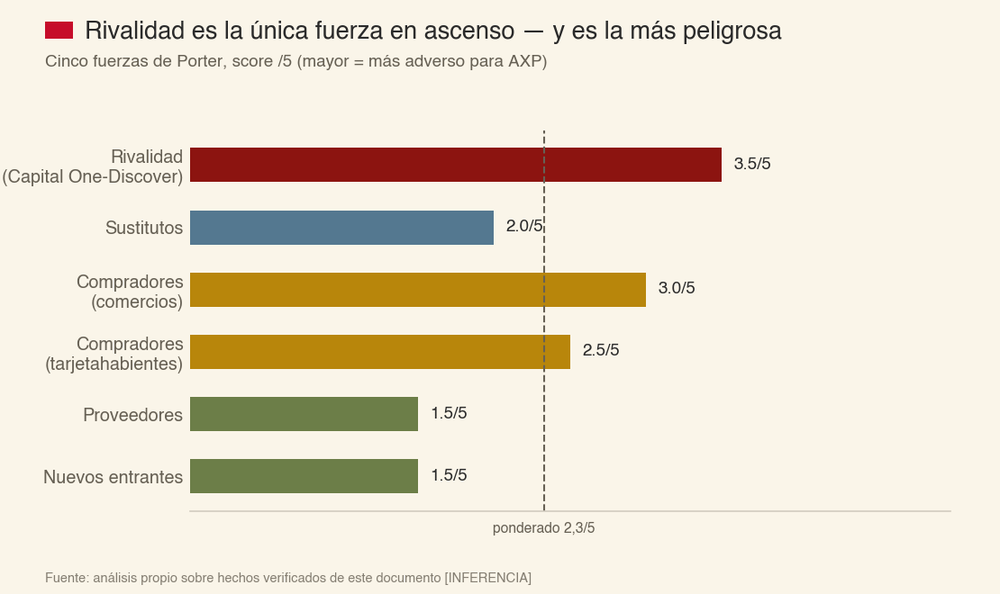

Barreras de entrada bajas en riesgo (nadie había replicado el modelo de circuito cerrado a escala desde 1985, hasta ahora) y poder de proveedores bajo (AXP es dueña de su propia pila tecnológica). El poder de los comercios es la fuerza más delicada de las cinco "tradicionales": AXP cobra tasas de descuento estructuralmente más altas que Visa/Mastercard, y tanto la Credit Card Competition Act (§4, descartada como amenaza directa por diseño legal) como el acuerdo Visa/Mastercard (§4, todavía preliminar) presionan en esa dirección de fondo, aunque ninguno alcanza a AXP directamente todavía. **La única fuerza que se ha movido de forma medible y reciente es la rivalidad — por una sola razón, con nombre propio.**

### Capital One / Discover — el competidor que ya no es una tesis, es un balance

El volumen de la "Global Payment Network" de Capital One (Discover + PULSE + Diners) fue de 189.612 M USD en el 2T2026, **+156% interanual** por la integración de Discover (HECHO, 10-Q de Capital One). El volumen de red de AXP en el mismo trimestre fue 516.800 M USD — todavía **2,7 veces mayor**.

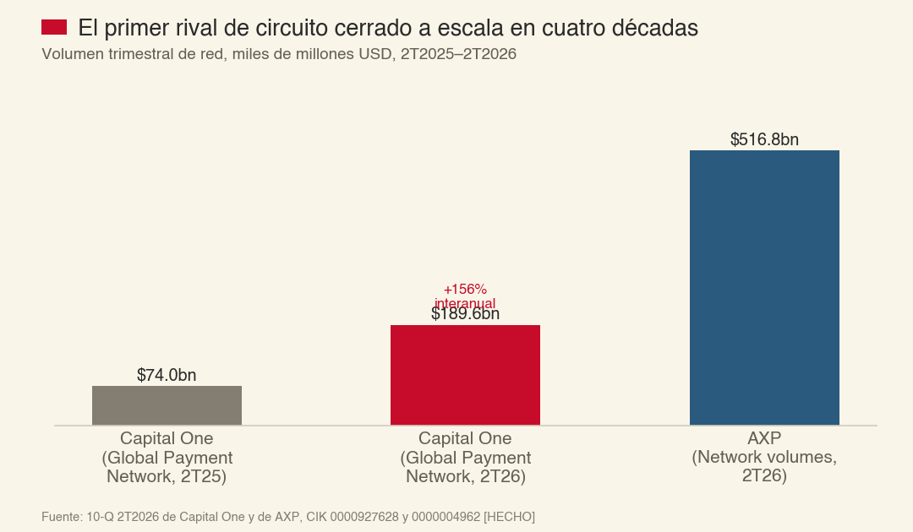

El objetivo declarado de Capital One es ≥2.500 M USD de sinergias hacia mediados de 2027, con tarjetas de crédito propias ya probándose en la red Discover. El propio 10-Q de Capital One reconoce como riesgo abierto la aceptación de comercios en su red recién adquirida — la misma variable que a AXP le costó una década cerrar.

### Comercio agéntico — el riesgo que la propia empresa no sabe cuantificar

El 10-K FY2025 menciona "agentic commerce" en al menos siete secciones distintas del documento, lenguaje que no existía en ediciones anteriores: agentes de IA autónomos que inician y ejecutan transacciones en nombre del usuario podrían "controlar el acceso a las decisiones de método de pago" y AXP podría tener que pagar para participar o negociar concesiones de precio. Toda la arquitectura de marca de AXP —el metal, el color, el salón VIP— es señalización social en el momento del pago. Un agente no señaliza: optimiza.

### El dato que el mercado sí parece estar leyendo — la desaceleración de nuevas cuentas

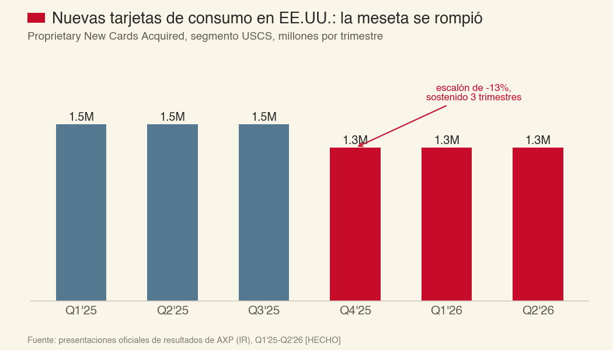

AXP publica cada trimestre, en su presentación oficial de resultados, las "Proprietary New Cards Acquired" por segmento. En el segmento de consumo de EE. UU., la serie es HECHO, no estimación: una meseta de 1,5 millones de tarjetas nuevas por trimestre durante los tres primeros trimestres de 2025, seguida de un escalón a 1,3 millones (−13%) que se ha sostenido durante los tres trimestres más recientes (4T2025, 1T2026, 2T2026) sin revertir. El propio CFO verbalizó la cifra de 1,5 millones en la llamada de resultados del 2T2025, justo antes del quiebre — coincidencia que refuerza la lectura de que el cambio es real, no ruido de un trimestre.

**Y la reacción del mercado al 1T2026 lo confirma.** AXP reportó el 23 de abril de 2026, antes de la apertura, un trimestre que superó el consenso en toda línea (EPS 4,28 USD, +18% interanual; ingresos +11%). **La acción cayó −4,3% ese mismo día** (de 332,90 a 318,55 USD, verificado contra precios de mercado en vivo) y seguiría cayendo un −1,4% adicional al día siguiente. La explicación, según cobertura contemporánea: la dirección reafirmó la guía anual en vez de elevarla pese al beat, y anunció mayor gasto en marketing y tecnología. **El mercado ya está leyendo la desaceleración de la máquina de unidades como una señal más importante que el beat de utilidades — exactamente la tensión que sostiene el §9 de esta tesis.**

---

## §6 · Crédito y capital regulatorio — la parte que sostiene la parte que gana el dinero

Si el 54,4% del beneficio viene de prestar, la calidad de ese libro y la solidez del capital que lo respalda no son contexto: son la tesis.

**DFAST 2026 (Reserva Federal, publicado 24-jun-2026, HECHO):** bajo el escenario severamente adverso, AXP registra la tasa de pérdida en tarjetas de crédito **más baja de los 32 bancos evaluados** — 9,5% contra un agregado de 17,1%, el extremo inferior de todo el rango bancario (9,5%-22,7%).

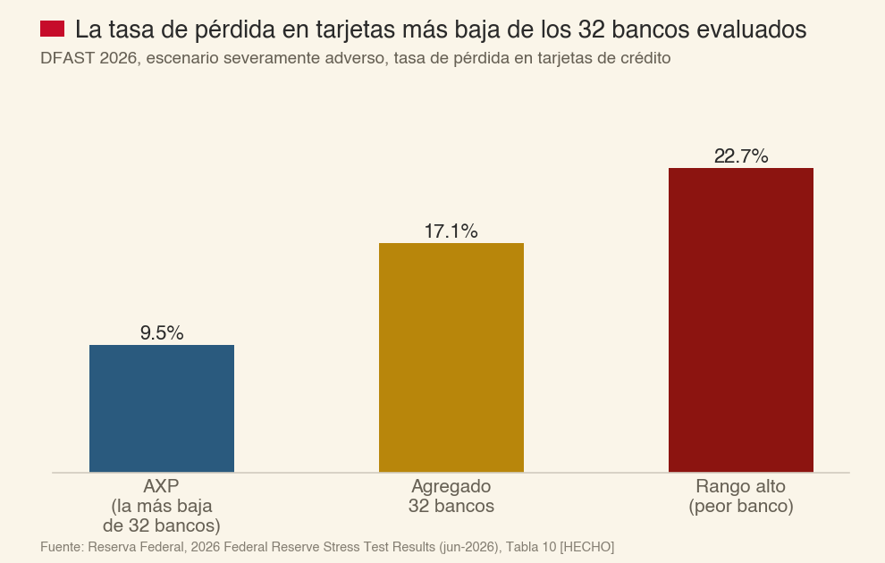

Su CET1 cae solo 0,8 puntos porcentuales bajo estrés (10,5%→9,7%) contra 1,6 puntos del agregado del sistema (12,8%→11,2%). **Advertencia honesta que hay que hacer antes de leer esto como una victoria:** el Stress Capital Buffer de AXP se mantiene congelado en el piso regulatorio de 2,5% hasta septiembre de 2027, no porque el test lo haya recalculado, sino porque la Reserva Federal votó en febrero de 2026 mantener los requisitos vigentes de todos los bancos mientras revisa la metodología. **Nadie, incluida AXP, recibió un SCB recalculado sobre el ciclo 2026.**

**Capital y balance, jun-2026 (HECHO):** CET1 10,4%, dentro del rango objetivo declarado de 10-11%; RWA 268.321 M USD (+3,4% en dos trimestres desde 259.448 M en dic-2025). Financiación: depósitos de clientes 72,7% del total, deuda de mercado 27,3% — mezcla notablemente estable en 2024-2026. Ratings Moody's A2 / S&P A- / Fitch A, los tres con perspectiva estable.

**Crédito — la serie que hay que mirar, no la que titula el comunicado:** tasa de castigo neto consolidada 2,2-2,3% en 2025-2026 (vs. 2,0% en 2023); morosidad a 30+ días 1,2-1,3%, ambas estables o mejorando levemente interanual en 2026. AXP no publica una cifra numérica de "mediana de ciclo" en sus filings; el CFO Christophe Le Caillec describió cualitativamente en la llamada del 1T2026 que el crédito "sigue muy fuerte y estable" y "por debajo de los niveles de 2019" — declaración cualitativa, sin cifra objetivo.

**Cambio regulatorio ya ocurrido, no prospectivo:** AXP cruzó de firma Categoría III a **Categoría II** durante el segundo trimestre de 2026, al superar los 75.000 M USD de actividad transfronteriza (promedio móvil de cuatro trimestres). Esto la somete a los requisitos PLENOS (sin el descuento del 85%) de LCR y NSFR, y a reporte diario de liquidez en vez de mensual — aunque el propio 10-Q aclara que el ajuste del 85% "continúa aplicando durante el periodo de transición". El DFAST 2026 todavía la clasifica como Categoría III porque usa el corte de datos de cierre de 2025; para agosto de 2026 esa clasificación ya está desactualizada. **Es una obligación regulatoria más estricta que ya entró en vigor, no un riesgo hipotético.**

---

## §7 · Gestión, cultura y gobernanza

Stephen Squeri es Chairman y CEO desde el 1 de febrero de 2018 (39-40 años en la empresa). Christophe Le Caillec es CFO desde agosto de 2023, sin cambios desde entonces. Ha habido dos salidas de alta dirección en el periodo reciente (Anré Williams, feb-2025; Douglas Buckminster, retiro efectivo mar-2026), ambas descritas como retiros planificados, sin señal de disrupción.

La prueba de fuego cultural de Amex no está en un memo de valores: está en un martes de septiembre de 2001, narrada en §1. Sigue siendo, veinticinco años después, la referencia interna de liderazgo bajo presión.

La compensación variable se rige por un "Company Scorecard" único: Shareholder 60% (crecimiento de ingresos 50% / EPS 25% / ROE 25%), Cliente 10%, Empleado 10%, Estratégico 20%. El resultado de 2025 fue "Significantly Outperform" — multiplicador de compañía 145% sobre 150% posible, multiplicador del CEO 125% sobre el máximo. La compensación total de Squeri en 2025 fue 46,2 M USD según la tabla oficial (SCT), o 48,1 M USD según la metodología propia del comité (+37% sobre objetivo). El 96% de la compensación anual es variable, ligada mayoritariamente a rendimiento relativo de TSR y ROE frente a un grupo de pares.

### Asignación de capital: recompras consistentes, insensibles al precio

AXP devolvió 7.600 M USD a los accionistas en 2025 (5.300 M de recompras + 2.300 M de dividendos), ~71% del beneficio neto disponible para comunes.

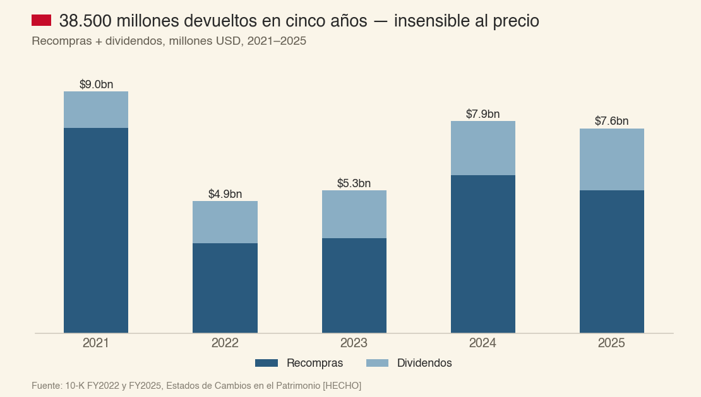

El patrón es de devolución de capital consistente y disciplinada en monto, pero sin sensibilidad visible a precio o valor intrínseco: el precio promedio pagado por acción en recompras subió cada año de 2023 a 2025 (157,33→294,05→360,65 USD), con el monto total recomprado también variando, sin evidencia de haber acelerado el ritmo durante caídas de mercado. Es la misma disciplina —devolver capital de forma consistente, sin intentar cronometrar el precio— que sostiene el registro de M&A prácticamente vacío desde 2020: la lección de Robinson III y Shearson Lehman (§1) parece haber quedado aprendida.

**La única operación corporativa relevante en curso, y hay que fecharla con precisión porque una fuente anterior la dio por cerrada sin estarlo:** AXP posee ~30,1% de Global Business Travel Group (NYSE: GBTG). El 2 de mayo de 2026, GBTG firmó un acuerdo de fusión para ser adquirida en efectivo por Long Lake Management Holdings a 9,50 USD/acción; AXP se comprometió a votar a favor. El comunicado de AXP del 4-may-2026 declaró que, al cierre, **espera** recibir ~1.500 M USD en efectivo y reconocer una ganancia pretax de ~975 M USD — cifras condicionadas, en futuro, no realizadas. Los accionistas de GBTG aprobaron la fusión el 3 de agosto de 2026 (94,95% de participación, prácticamente unánime), pero **a la fecha de esta tesis la operación sigue sin cerrar**: pendiente de aprobación regulatoria, GBTG sigue cotizando de forma independiente en NYSE (con Forms 4 y 144 de insiders presentados hasta el 25 de agosto), y ni AXP ni GBTG han presentado el 8-K de cierre (Item 2.01) que consumaría la transacción. El propio 10-Q de AXP del 2T2026 lo confirma: la ganancia "no está reconocida" y la operación sigue descrita como "pending acquisition". AXP retiene el acuerdo de licencia de marca y comercial con GBT tras la venta. **Es un catalizador de capital real y probablemente cercano, pero condicional — no un hecho ya consumado.**

### El "skin in the game" real es de Berkshire, no de la gerencia

El consejo es 92,9% independiente y los comités 100% independientes. Pero el capital propio que la gerencia arriesga junto al accionista —lo que en inglés se llama *skin in the game*, "piel en el juego"— no viene de los ejecutivos: los 27 ejecutivos y directores combinados poseen apenas ~0,073% de las acciones en circulación. La mayor apuesta de convicción sobre AXP en seis décadas no la hace quien la dirige hoy, sino Berkshire Hathaway (22,1%, construido entre 1991 y 1994 — la segunda apuesta de Buffett sobre esta empresa, treinta años después de la primera, ver §1), bajo un acuerdo de pasividad de 1995 que ata el voto de Berkshire a las recomendaciones de la Junta. Es una paradoja curiosa: la convicción de más largo plazo sobre este negocio la sostiene un tercero que volvió a comprar hace más de treinta años, no quienes lo dirigen hoy. La compensación del CEO frente al valor de acciones propias que posee da un ratio de aproximadamente 1,7 veces — modesto para un ejecutivo de su nivel.

### El historial regulatorio no es impecable

En 2019, los reguladores ordenaron a Amex devolver 85 millones de dólares a aproximadamente 250.000 clientes y pagar 27,5 millones en multas por prácticas de marketing y cobranza [HECHO, pendiente re-verificación fresca de la cifra exacta y el regulador — ver nota en §5]. No es un patrón de mala conducta sistemática, pero tampoco es un historial en blanco, y merece registrarse con la misma honestidad que el resto de este documento.

---

## §8 · Riesgos: matriz y pre-mortem, escrito antes de valorar

*Es 29 de agosto de 2031 y esta tesis salió mal. ¿Qué pasó?* Esta sección se escribió y congeló antes de conocer el resultado final de la matriz de valoración de §10, tal como exige el método — cada mecanismo lleva la métrica que lo confirmaría y la fecha en que hay que mirarla.

| Mecanismo | Qué pasa exactamente | Qué mirar y cuándo |
|---|---|---|
| **1 · El punto de venta cambia de norma social** | El acuerdo Visa/Mastercard obtiene aprobación final; los grandes comercios empiezan a rechazar tarjetas premium o a recargarlas como práctica rutinaria, forzando a AXP a igualar condiciones aunque no sea parte del litigio | Tasa de descuento (discount revenue/billed business) cayendo por debajo de 2,15% dos trimestres seguidos; cualquier mención en 10-Q de "cambios en nuestras prácticas comerciales" en respuesta al acuerdo. Ventana: aprobación final esperada 2027 |
| **2 · El escudo anti-steering se agrieta del todo** | *Pizza Hazel* pierde en el Primer Circuito con la misma teoría de *5-Star*, y el litigio de clase resultante obtiene una victoria en el fondo, no solo procesal, contra las cláusulas de no discriminación — a pesar de que el jurado de *Moskowitz* (§4) ya falló a favor de AXP en el fondo de un reclamo casi idéntico en agosto de 2025 | Fallo del Primer Circuito en Pizza Hazel; cualquier resolución de fondo (no procesal) en el litigio de clase de 5-Star. Sin fecha fija; revisar cada 10-Q |
| **3 · El crédito revierte a su propia mediana** | La tasa de castigo neto, hoy en 2,2-2,3%, sube hacia el rango 3,5-4,5% que tuvo en la crisis anterior, sin que sea una recesión severa — solo el fin de un ciclo benigno | Tasa de castigo neto (Guide 3, 10-K anual) superando 3,5% dos trimestres seguidos. Ventana: cualquier 10-Q desde ahora |
| **4 · La suscripción deja de crecer en contribución neta** | Card Member services y recompensas siguen creciendo más rápido que Net card fees, comprimiendo el margen de la línea de suscripción hasta hacerla casi gratuita para AXP | Ratio (recompensas+desarrollo de negocio+servicios al titular)/(discount+cuotas) superando 70% en un ejercicio completo. Ventana: 10-K FY2026, feb-2027 |
| **5 · Capital One-Discover cierra la brecha de aceptación en la dirección equivocada** | El rival de circuito cerrado gana cuota medible en comercios/categorías donde Amex históricamente domina (viajes, retail de lujo), mientras AXP sigue creciendo en volumen agregado pero perdiendo el margen relativo de su ventaja de red | Cuota de comercios reportada por terceros o por Capital One en categorías premium; migración de rieles completada según el plan a 2 años de Capital One. Ventana: informes trimestrales de Capital One 2026-2027 |
| **6 · La sucesión, sin plan visible** | Squeri lleva 39-40 años en la empresa y 8 en el cargo; una salida no planificada dejaría a AXP sin el arquitecto de la estrategia actual en medio de dos litigios activos | Cualquier 8-K Item 5.02 de cambio de CEO sin sucesor preanunciado. Sin fecha fija |
| **7 · Categoría II encarece el fondeo** | El paso a requisitos plenos de LCR/NSFR (sin el descuento del 85%) obliga a más financiación estable a plazo, presionando el coste de fondeo justo cuando termina el periodo de transición | NSFR a calibración plena cayendo bajo 105%; cualquier emisión de deuda con spread notablemente superior a los +62pb de abr-2026. Ventana: informes de 2027 |

> **PAUSA REFLEXIVA**
> De los siete mecanismos, cinco (1, 2, 3, 5, 7) no dependen de que AXP haga algo mal — dependen de reguladores, tribunales, un rival nuevo y el ciclo de crédito. Eso es la firma de un negocio con foso real. También es, exactamente, la razón por la que el precio de entrada importa tanto: cuando lo único que puede fallar es en gran medida lo que la empresa no controla, el único control que le queda al inversor es cuánto paga.

---

## §9 · La percepción variante

El consenso implícito en el precio de mercado es que la rentabilidad actual sobre capital regulatorio —41,7%, la más alta que AXP ha sostenido nunca de forma prolongada— no revierte: se mantiene, o incluso mejora levemente, para siempre. Es una lectura defendible línea a línea (veinte años de evidencia de foso real, gestión disciplinada, crédito mejor que cualquier banco comparable) pero que no está incorporando varios datos concretos y verificables hoy que el consenso superficial —el que mira el titular de resultados trimestrales, no los filings ni los tribunales— no tiene:

1. Que AXP acaba de perder, hace diez días, su primera línea de defensa procesal en un litigio activo que ataca directamente el mecanismo de precios validado por Ohio v. Amex.
2. Que el acuerdo Visa/Mastercard que redefine las reglas del punto de venta en Estados Unidos ya tiene aprobación judicial preliminar, no solo una propuesta de noviembre de 2025 archivada en un factor de riesgo.
3. Que por primera vez en cuarenta años existe un competidor con la misma estructura de circuito cerrado y capital real para intentar replicarla.
4. Que la propia AXP no publica el dato que resolvería esta tesis con un valor puntual —la separación entre su negocio prestamista y su negocio no prestamista—, lo que en la práctica significa que el mercado está poniendo precio a una variable que ni siquiera puede auditar con precisión.

No hay variante articulable con un dato concreto que diga "el mercado tiene razón en pagar esto porque no ve X" — al contrario: los datos que el mercado parece no estar mirando apuntan en la dirección conservadora, no en la optimista. Si acaso, la variante corre en sentido contrario al que suele correr en un caso de "no comprar todavía": no es que el mercado ignore una fortaleza; es que ignora, o descuenta a un ritmo demasiado lento, varios deterioros recientes y fechados.

---

## §10 · Cuánto vale y a qué precio se compraría

### Por qué esta tesis llega a $189-229 y la del 9-jul-2026 llegó a $387 — la reconciliación, con números

Antes de construir la valoración propia, hay que resolver la pregunta que motiva este encargo: dos documentos, separados por siete semanas, sobre la misma empresa, llegan a un valor justo casi el doble el uno del otro. **No es que uno tenga razón por instinto y el otro por rigor — es que usan motores incompatibles, y uno de los dos tiene un defecto de construcción ya documentado y corregido en el resto de la cartera.**

**Primero, lo que NO explica la diferencia:** no es el precio de mercado (335,94→333,31 USD, -6,4% en siete semanas, un movimiento pequeño frente a la brecha de valor) ni es que uno haya encontrado un knock-out que el otro pasó por alto — ninguno de los dos dispara un knock-out duro.

**Lo que sí la explica, con aritmética:**

| | Tesis del 9-jul-2026 (sistema retirado) | Esta reconstrucción (Motor v3.1) |
|---|---|---|
| **El flujo (numerador)** | "Owner earnings" = beneficio neto por acción de los últimos doce meses, sin ajuste. Declarado explícitamente: "NO FCF-SBC" | Beneficio Distribuible = beneficio neto − dividendo preferente − **ΔCET1** (el capital regulatorio que hay que retener para sostener el crecimiento del balance) |
| **La fórmula terminal** | Perpetuidad de Gordon simple: flujo/(WACC−g), un solo escalón | Senda explícita a 10 años en tres tramos, con el ROCET1 convergiendo estructuralmente desde el 41,2% actual hacia el escenario terminal — nunca asumido plano |
| **La tasa** | WACC 9,5% (beta 1,1, sin distinguir cost-of-equity de WACC en un prestamista) | Coste del equity puro, CAPM, 9,15% (beta propia 1,03, calculada por regresión) |
| **Resultado** | PWFV central US$387 | Banda central US$189-229 (motor blended) / ~165-217 (motor SOTP, ver más abajo) |

**La pieza que más pesa, con números reales:** el beneficio neto de los últimos doce meses de AXP es 11.446 M USD (dato reportado real: FY2025 10.833 − 1S2025 5.469 + 1S2026 6.082). Pero AXP no puede repartir ese beneficio íntegro y seguir creciendo: su balance de activos ponderados por riesgo (RWA) está creciendo ~7% anual, y cada dólar nuevo de RWA exige retener 10,5 centavos de capital regulatorio adicional (el punto medio del rango objetivo 10-11% que la propia empresa declara). Descontando esa retención, el flujo que de verdad queda libre para el accionista en el primer año de esta reconstrucción es de aproximadamente 9.000-9.200 M USD — **~20% menos que el beneficio neto crudo que usa el motor anterior.** Ese 20% de diferencia en el numerador, compuesto a través de una perpetuidad, es la mayor parte de la brecha entre $387 y el centro de la banda de esta reconstrucción.

**La segunda pieza:** una perpetuidad de Gordon de un solo escalón no tiene forma de imponer que la rentabilidad sobre capital converja hacia algo más moderado que el nivel actual — asume, por construcción, que el 41,2% de hoy (o lo que sea que el analista haya puesto como "g" implícito) se sostiene sin fricción indefinidamente. Es exactamente el defecto que la recalibración del Motor de Valoración v3.1 (26-ago-2026) documentó y corrigió en el resto de la cartera de este archivo, con casos donde una perpetuidad sin disciplina de convergencia produjo primas de +588% frente a empresas que, miradas con una senda explícita de diez años, resultaban razonablemente valoradas. **AXP no es una excepción a esa lección: es un caso más de la misma familia de error.**

**Y lo más importante, que hay que decir con la misma honestidad con la que se corrige el error: en la conclusión operativa, los dos documentos NO discrepan.** La tesis del 9-jul-2026 también encontró que el precio no ofrecía margen de seguridad (asimetría 0,30:1 contra un mínimo de 2:1 exigido; zona "Justo" con solo 8% de colchón) y también concluyó no comprar — con la palabra "VIGILAR", que era la salida disponible en el sistema de entonces. El método actual no tiene esa salida: el Paso 11 solo admite COMPRAR, NO, NO COMPRAR TODAVÍA o NO DECIDIBLE, nunca "vigilar" como cajón sin salida. **Dos motores incompatibles, evaluados con siete semanas de diferencia, convergen en la misma dirección operativa aunque no en la misma cifra — eso es, si acaso, una validación cruzada más fuerte que si solo existiera uno de los dos.**

### El coste del capital, construido desde el mercado — candado B, en su sentido correcto

La regla es innegociable: la tasa de descuento se construye siempre desde el mercado, nunca desde un juicio de calidad. En prestamistas hay una corrección adicional que hay que declarar por escrito: **no se usa WACC.** Los depósitos y la deuda de un prestamista no financian la operación — son la materia prima de la operación. Su coste ya está restado, una vez, dentro del margen de intereses. Mezclarlo otra vez en la tasa de descuento sería contarlo dos veces. Se descuenta, por tanto, con el **coste del equity puro (CAPM)**.

| Componente | Valor | De dónde sale |
|---|---|---|
| Tipo sin riesgo (rf) | 4,67% | Bono del Tesoro a 10 años, serie H.15 de la Reserva Federal, 27-ago-2026 [HECHO] |
| Beta de AXP | 1,03 | Propia, 60 meses mensuales, regresión sobre precios de Interactive Brokers, ajustada Blume (0,67×1,037+0,33). R²=0,41. Contrastada contra dos proveedores externos: 1,05 y 1,06 [INFERENCIA sobre datos de mercado] |
| Beta sectorial alternativa | 1,15 | Media de Capital One (1,01) y Synchrony (1,29), mismo método [INFERENCIA] — se usa la MENOR de las dos: 1,03 |
| Prima de riesgo de mercado (ERP) | 4,35% | Punto medio del rango implícito de mercado ago-2026 (4,2-4,5%) [SUPUESTO declarado] |
| **Coste del equity (r)** | **9,15%** | 4,67% + 1,03 × 4,35% |

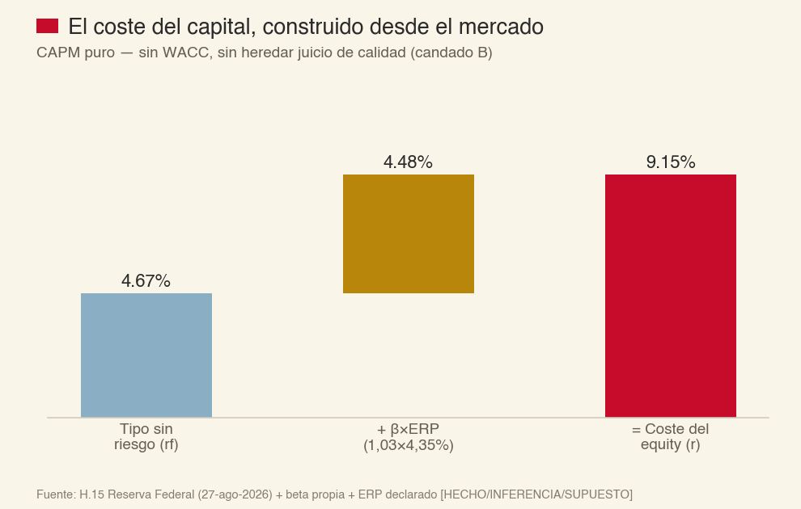

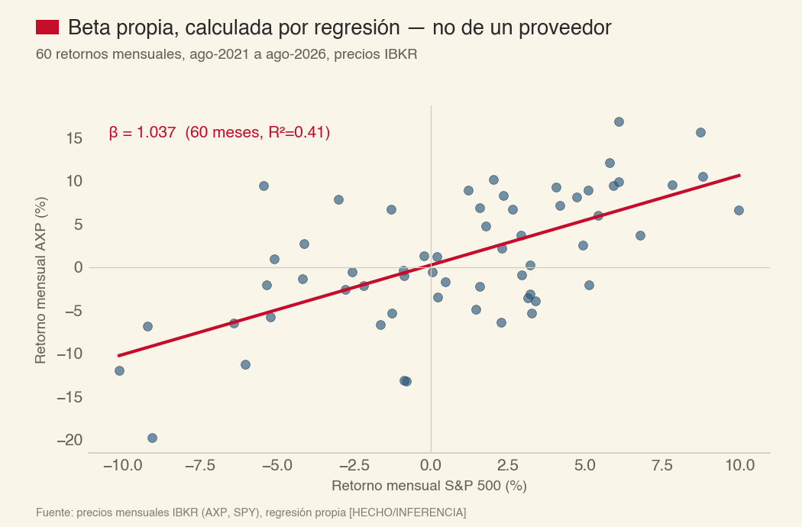

**En román paladino:** el bono del Tesoro paga 4,67% sin arriesgar nada. Pedirle a la acción de un prestamista apalancado casi nueve veces menos de 9 puntos por arriesgar el capital es aceptar que te paguen poco por mucho riesgo. Que la beta propia (1,03) y la de los pares de crédito más cercanos (1,01 y 1,29) converjan alrededor de 1 es la mejor señal de que el número no está inflado ni desinflado a mano — y es sustancialmente distinto del 1,1 que usó la tesis anterior sin mostrar el cálculo detrás.

### Qué gana de verdad un prestamista

Una fábrica compra una máquina para poder vender; la máquina es capex y la venta es el ingreso, y son cosas distintas. Un prestamista no compra una máquina para poder prestar: prestar ES la venta. El dinero que sale a la calle no es una inversión que haya que restar del flujo: es el producto, y vuelve con interés. Lo que sí hay que restar es el **capital regulatorio** que la ley obliga a inmovilizar detrás de cada dólar prestado, que el accionista deja de poder cobrar mientras esté ahí.

```
Beneficio Distribuible = Beneficio neto − dividendo preferente − ΔCET1
donde CET1 = k* × RWA  (identidad estructural: el capital regulatorio consumido
es exactamente el que la propia política de la empresa exige mantener)
```

k* = 10,5% (punto medio del rango objetivo 10-11% que la propia AXP declara por escrito en su 10-K/10-Q, HECHO). RWA a jun-2026: 268.321 M USD (HECHO), creciendo +3,4% en dos trimestres (~7,0% anualizado). CET1 real: 27.779 M USD, prácticamente en su objetivo (28.174 M USD, dentro de un 1,4%). Beneficio neto de los últimos doce meses (dato reportado real, no estimado: 10.833 FY2025 − 5.469 1S2025 + 6.082 1S2026): **11.446 M USD.**

**ROCET1 blended actual (LTM) = 11.446 / 27.779 = 41,2%.** Este es el número que, promediado como un único agregado, decidió la primera versión de esta valoración. Y es exactamente ahí donde el candado A bicameral (§11) encontró su golpe más serio: el ángel argumentó, con razón, que forzar este número blended a converger linealmente hacia un "par de sector" genérico no está evidenciado por seis años de ROE estable — y que hacerlo probablemente castiga por igual dos negocios que no se parecen en nada. **Lo que sigue es la reconstrucción de esa crítica con números, no con argumento.**

### El motor mejorado — por qué un solo ROCET1 no basta

AXP no es un prestamista con una tienda de regalos al lado. Es, literalmente, **dos negocios con economías de capital opuestas cosidos en la misma acción**:

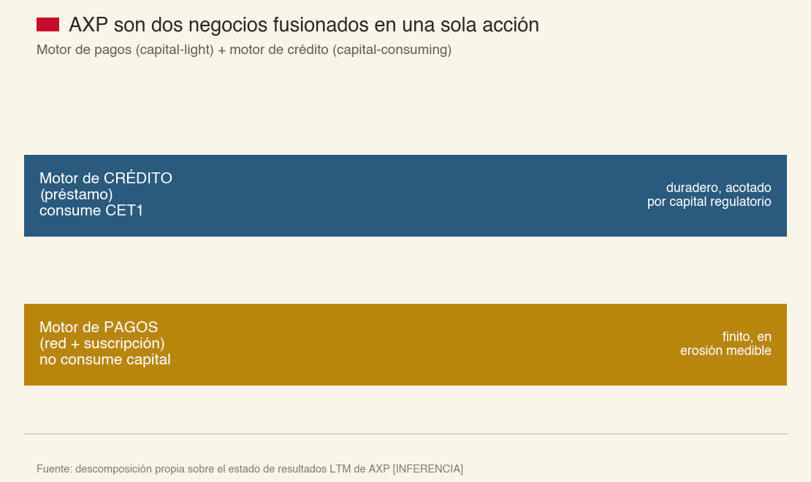

- **El motor de pagos** (descuento a comercios + cuotas de suscripción, menos recompensas, servicios al titular, marketing y desarrollo de negocio) **no consume capital regulatorio**. Es una máquina de peaje: cobra por transacción y por membresía, no presta nada.
- **El motor de crédito** (margen de intereses menos provisiones) sí lo consume — cada dólar que crece el balance de préstamos exige retener 10,5 centavos de CET1 que el accionista deja de poder cobrar.

Promediar los dos en un ROCET1 único y hacerlo decaer como si fuera un solo negocio **castiga al motor de pagos por un problema que no es suyo** (la necesidad de capital) y **disfraza el problema real del motor de crédito** (si su rentabilidad decae, decae sobre una base de capital que sigue creciendo, no sobre un negocio sin capital). Separarlos, con datos LTM reales del propio estado de resultados de AXP:

| | Motor de pagos (directo, sin gasto compartido) | Motor de crédito (directo, sin gasto compartido) |
|---|---|---|
| Cálculo | Descuento + cuotas − recompensas − servicios al titular − marketing − desarrollo de negocio | Margen de intereses − provisiones |
| LTM (M USD) | **10.033** | **13.312** |

La suma de estos dos números, más los ingresos por servicios (7.835 M) menos el gasto compartido de salarios y otros (16.416 M), reproduce el beneficio antes de impuestos real (14.764 M) sin residuo. **Pero ese gasto compartido de 16.416 millones — casi 12 puntos porcentuales de margen — es un dial que AXP no divulga cómo repartir entre los dos negocios, y moverlo cambia la conclusión de forma material:**

| Cómo se reparte el gasto compartido | Motor de pagos BAI | Motor de crédito BAI | ROCET1 del crédito, aislado |
|---|---|---|---|
| Por margen directo de cada motor (Reparto A) | 6.345 | 8.419 | **23,8%** |
| Por ingresos de cada motor (Reparto B) | 3.764 | 11.004 | **31,1%** |

**Y este es el hallazgo que cambia la conversación: incluso bajo el reparto MÁS desfavorable para el crédito (Reparto A), su rentabilidad aislada sobre capital regulatorio —23,8%— ya está muy por encima del "15% par de sector" que la primera versión de este motor usaba como suelo.** El suelo genérico no tenía un mecanismo detrás; era una analogía con bancos que no comparten la calidad de crédito de AXP (la más alta de los 32 bancos del DFAST, §6). El motor de crédito de AXP, aislado, no necesita "un foso" para valer más que un banco cualquiera — ya vale más, hoy, medido.

### Valorando cada motor por separado

**El motor de crédito** se valora con la misma disciplina de capital regulatorio de antes (CET1=k*×RWA, senda a 10 años, terminal g∞), pero ahora sobre su propio flujo aislado — y con dos posturas declaradas sobre la forma de la convergencia, la disputa exacta del candado A:

- **Postura conservadora (diablo):** convergencia lineal desde el año 1.
- **Postura del ángel:** meseta de 4 años (el negocio de crédito de AXP lleva 6 años sin desgaste medible) y convergencia en los 6 restantes.

**El motor de pagos** no consume capital, así que se valora como lo que es: una anualidad, no una perpetuidad automática — porque el §4 y el §9 ya documentaron un mecanismo real de erosión (la contribución bruta de la suscripción cayendo, el "Reloj 2"). Tres posturas sobre cuánto dura:

- **Pesimista:** decae linealmente a cero en 6 años (el ritmo de erosión medido en 2024-2026, extrapolado sin freno).
- **Central:** decae a cero en 10 años (el horizonte completo del modelo, sin asumir que el negocio sobrevive después).
- **Optimista:** se estabiliza en su nivel actual, para siempre (el caso de que el "ciclo de refrescos" de producto —§1— sea suficiente para mantener el negocio de pagos en su tamaño actual, no para hacerlo crecer).

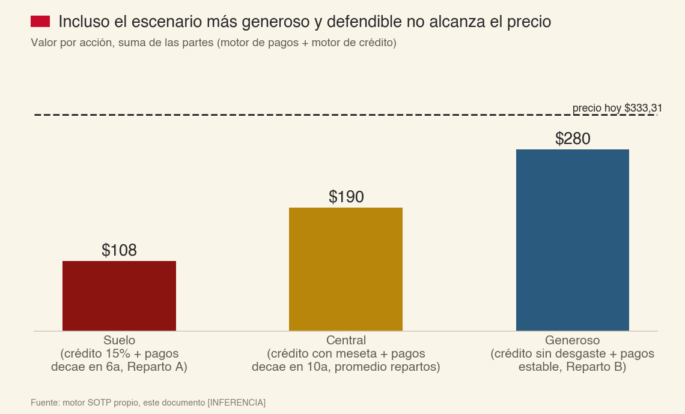

| Escenario combinado | Reparto A | Reparto B |
|---|---|---|
| **Suelo** (crédito converge a 15% desde año 1 + pagos decae en 6 años) | ~108 USD | ~123 USD |
| **Central** (crédito con meseta, converge a ~5pp bajo el nivel actual + pagos decae en 10 años) | ~165 USD | ~217 USD |
| **Generoso** (crédito sin desgaste, meseta permanente + pagos estable para siempre) | ~249 USD | ~280 USD |

**La conclusión que de verdad importa: incluso en el escenario más generoso que este motor puede construir sin recurrir a un artefacto —el crédito no se desgasta nada y el negocio de pagos deja de erosionarse por completo, ambos supuestos ya en el extremo bondadoso de lo defendible— el valor no llega a 333,31 USD.** Llega, como mucho, a 280. Esto es un resultado distinto y más honesto que el de la primera versión: no dice "AXP vale poco porque su rentabilidad debe converger a la de un banco genérico" — dice **"incluso dándole a AXP el beneficio de la duda en cada dial que la evidencia no cierra del todo, el precio de hoy sigue pidiendo más de lo que el negocio, entendido a fondo, puede entregar."**

### La pregunta Buffett — ¿qué diría el propio Buffett de este precio?

Buffett no exige el descuento de Graham para un negocio excepcional — compró Coca-Cola en 1988 a 15 veces beneficios con el bono del Tesoro al 8,85%. Traducido a la tasa de hoy (4,67%), esa misma exigencia de prima sobre el bono equivale a pagar hasta **~28-29 veces** beneficio del propietario. AXP, a 333,31 USD, cotiza a **≈23-24 veces** el flujo del motor de crédito aislado más el de pagos combinados bajo el reparto más favorable — **dentro** de la banda que el propio historial de compras de Buffett considera aceptable para un negocio de esta calidad. **Esta es la respuesta honesta a por qué el instinto de "Buffett lo compraría hoy" no está mal, entendido como múltiplo sobre beneficio contable.**

Pero el múltiplo no es la pregunta que este método hace. La pregunta es la TIR sobre el flujo que el accionista puede *retirar* sin dañar el negocio — y ahí es donde entra la diferencia entre un negocio industrial (donde el múltiplo sobre beneficio contable y sobre owner earnings casi coinciden) y un prestamista regulado (donde una fracción grande y creciente del "beneficio" tiene que quedarse dentro para financiar el balance). **Buffett mismo aplicaría esta misma corrección** — es, literalmente, la definición de owner earnings que él mismo escribió en 1986, extendida por este documento al caso específico de un banco. Bajo esa métrica correcta, incluso el escenario más generoso de este motor no alcanza el precio de hoy. **Las dos lecturas no se contradicen: son la misma disciplina de Buffett, aplicada con el rigor que él mismo exigiría a un balance que crece.**

### Panel de inversores — dónde la calidad genera consenso y dónde no

La fusión de doce mentores gobierna el instinto casual de esta casa; el panel formal de una Ultra Tesis, por decisión de ADN-QG12, son los nueve canónicos. Se citan aquí, con nombre, precisamente porque **la divergencia entre ellos es la señal, no el acuerdo** — y sirve como el contraste cualitativo que el candado A no puede dar por sí solo.

| Inversor | Veredicto | El porqué, en una frase |
|---|---|---|
| **Graham** | NO | Sin margen de seguridad cuantitativo clásico (ni activo neto, ni P/E de ganga); Graham, además, desconfiaba estructuralmente de valorar financieras apalancadas con sus herramientas |
| **Buffett** | MANTENER, no añadir | El negocio es exactamente el tipo que compraría dos veces en su vida (§1) — pero su propia definición de owner earnings, aplicada con rigor a un balance que crece, no autoriza pagar 333 hoy (ver "la pregunta Buffett", arriba) |
| **Munger** | MANTENER, con reserva | Aprecia el foso de coste de cambio (puntos) y la disciplina de asignación de capital de Squeri; le incomodaría la opacidad de que AXP no separe su negocio prestamista del que no lo es — invertir el problema: "si quisiera esconder que mi banco se parece cada vez más a un banco, ¿qué dejaría de publicar?" |
| **Lynch** | VIGILAR | Pasa la prueba de los dos minutos con nota alta; el PEG (≈20x sobre un crecimiento de ingresos de ~10%) está en el filo de lo que llamaría razonable, no en zona de ganga |
| **Fisher** | VIGILAR | La gestión y el scuttlebutt (§1, §7) son sobresalientes; pero Fisher quería pista de crecimiento larga y sin ambigüedad, y la desaceleración de nuevas cuentas (§5) es exactamente el tipo de señal que le haría llamar a competidores y clientes antes de comprar más |
| **Templeton** | NO | Compra en el punto de máximo pesimismo; AXP cotiza cerca de su rango de 52 semanas, no en una zona de pánico — no hay pesimismo que comprar |
| **Marks** | ESPERAR | El péndulo del mercado está en complacencia moderada sobre un negocio con riesgo de ciclo de crédito real (§6); "segundo nivel de pensamiento" dice esperar a que el precio incorpore la incertidumbre del ciclo, no perseguirla |
| **Seilern** | NO, por diseño | Su propio criterio de calidad excluye estructuralmente a bancos y financieras apalancadas del universo Quality Growth — no es un juicio sobre AXP, es un límite de clase de activo que él mismo fijó |
| **Terry Smith** | NO, por opacidad | Su objeción histórica y explícita a los bancos —"no se puede saber si un banco es una buena inversión mirando los números, porque no se sabe qué hay realmente en el balance"— es literalmente el límite que este documento nombra en §2 y §10: AXP no publica la separación prestamista/no-prestamista |

> **PAUSA REFLEXIVA**
> Tres inversores (Buffett, Munger, Lynch/Fisher en zona de vigilancia) reconocen la calidad sin reservas y frenan solo en el precio o en una señal de crecimiento concreta. Tres (Seilern, Terry Smith, Graham) frenan **antes de llegar al precio**, por el propio diseño de su círculo de competencia — no encuentran a AXP "cara": encuentran que un banco apalancado no es la clase de activo que su método fue construido para medir. Y dos (Templeton, Marks) frenan por lectura de ciclo, no de negocio. **Ningún inversor de los nueve dice "comprar hoy" sin condición — pero tampoco ninguno dice que el negocio sea malo.** Es la misma tensión que sostiene todo este documento, dicha con nueve voces distintas en vez de una.

### El mapa operativo

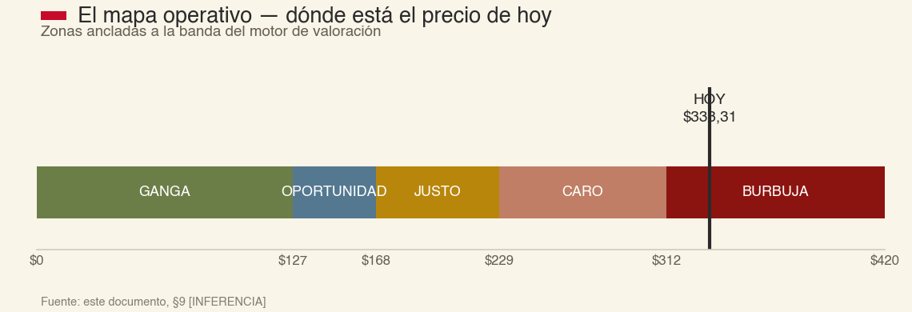

### Las cuatro triangulaciones

| Prueba | Resultado |
|---|---|
| Earnings yield (beneficio distribuible LTM / capitalización) vs. rf | 5,08% vs. 4,67% — prima de solo 41 puntos básicos sobre el bono sin riesgo |
| Múltiplo propio (P/beneficio distribuible corriente) | ≈23-24× — dentro de la banda "Buffett/Coca-Cola 1988" traducida a tasas de hoy |
| Múltiplo de pares del mismo mecanismo (P/E trailing) | AXP 20,2× vs. Visa 32,5× vs. Mastercard 32,7× — descuento esperable por mezclar red con crédito, no una ganga |
| Precio pagado por insiders con dinero propio, últimos 14 meses | **Cero.** Ver §7 |

**Test de trampa de valor:** no aplica. No hay de-rating — el precio ha subido, no bajado, frente a los fundamentales, y el negocio está sano en cada métrica operativa. Es el caso inverso al que este test fue diseñado para atrapar: **negocio excelente, precio que exige perfección eterna — pero, con el motor separado por partes, "perfección eterna" ya no es una frase retórica: es medible en dólares, y el negocio se queda a unos 50-80 dólares de alcanzarla, no a 200.**

### Referencia — el motor blended (agregado), como segunda triangulación

El motor original de esta tesis (ROCET1 blended, sin separar pagos de crédito) sigue siendo una referencia útil, precisamente porque converge de forma independiente a una banda parecida:

| ROCET1∞ \ g∞ | 3,0% | 4,0% | 5,0% |
|---|---|---|---|
| Suelo 15% | 127,17 | 133,11 | 141,89 |
| Central 25% | 188,58 | 204,81 | 228,84 |
| Techo 40% (sin desgaste desde el 41,2% actual) | 280,69 | 312,36 | 359,27 |

**Ratio máximo/mínimo = 2,83 (blended) frente a ~2,3-2,6 (SOTP) — ambos por encima del umbral 2,0. NO DECIDIBLE a un punto bajo cualquiera de los dos motores.** A 333,31 USD y g∞=4,0%, el DCF inverso del motor blended exige un ROCET1∞ de 42,9% — más alto que el 41,2% actual. La TIR esperada a 10 años del motor blended no supera la tasa exigida (9,15%) en ninguna celda salvo Techo/g5,0% (9,47%, por 32pb) — y el motor SOTP, más riguroso, ni siquiera en su escenario más generoso llega a esa tasa. **Los dos motores, construidos con lógicas distintas, convergen en la misma zona de valor y en la misma conclusión operativa — eso es la validación cruzada más fuerte que este documento puede ofrecer.**

---

## §11 · Diablo contra ángel

Las dos cámaras corrieron en sesión limpia, en paralelo, e independientes entre sí — ninguna vio el monólogo de esta redacción, ninguna vio a la otra. Ambas recibieron únicamente el paquete estructurado de los Pasos 1-9.

**El abogado del diablo, los tres golpes:**
1. **El moat:** las dos grietas de §4 no son ruido independiente — atacan el mismo mecanismo (la capacidad de AXP de imponer condiciones sin que el comercio pueda negociar colectivamente). Aporta un dato NUEVO no declarado en el paquete: 5.155 arbitrajes simultáneos presentados contra AXP es la firma de una campaña de *mass arbitration* — la estrategia legal diseñada explícitamente para volver el arbitraje contra quien lo redactó, y que ya funcionó una vez.
2. **La senda de reinversión:** el motor ancla el crecimiento de los años 1-2 en el dato HECHO más favorable disponible (RWA +7% anualizado, solo 2 trimestres) en el mismo momento en que la dirección lleva 4 comunicados consecutivos sin repetir su aspiración numérica plurianual.
3. **La asimetría del Paso 9:** con una beta de pares igualmente defendible (1,15 en vez de 1,03) y ERP en el extremo alto del rango declarado (4,5%), r sube a 9,85% (+70pb) — sin tocar ROCET1∞ ni g∞. Bajo supuestos igualmente defendibles dentro de los rangos que el propio expediente reconoce como válidos, su estimado central adversarial cae a **150-185 USD/acción**.

Retira explícitamente: el ataque sobre concentración de cobrand (Delta) — es laguna de investigación, no evidencia de daño; y los tres knock-outs de SBC/restatement/ROIC, que la evidencia HECHO cierra limpio. Sesgo nombrado: anclaje al dato más reciente y saliente. Falsable duro: crecimiento de RWA en el 10-Q de 3T2026 (finales de oct-2026) — si desacelera bajo ~6,5% anualizado, el ancla de años 1-2 queda falsificada de forma directa.

**El abogado del ángel, los tres golpes:**
1. **Parámetros de r:** retira explícitamente el ataque sobre beta ("no hay caso... no existe un rango igualmente defendible por debajo de 1,03") y sobre g∞ ("no hay palanca honesta aquí"). Señala dos palancas menores y cuantificables: ERP al extremo bajo (4,2%) baja r ~15pb; k* real observado (10,35%, jun-2026) está por debajo del punto medio (10,5%) usado en el motor.
2. **El golpe grande, sobre la forma del motor:** el ROE/ROCET1 de AXP no se ha erosionado ni un punto en 6 años consecutivos (2021-2026, HECHO). Imponer convergencia LINEAL desde el año 1 hacia el ROCET1∞ no está evidenciado por ese historial. Reponderando con esa evidencia, su central honesto sube a **260-300 USD/acción**.
3. **La base del año-0:** el LTM (jun-2026) probablemente rezaga el run-rate real, porque la guía FY2026 fue elevada en jul-2026 a un crecimiento de EPS de +12,5%/+16,4% que el LTM usado como ancla no refleja todavía.

Retira explícitamente y con precisión técnica: el marco sugerido en el propio encargo de esta tesis ("el crédito viaja sobre un balance que financian otros") **no encaja con la estructura real de AXP** — a diferencia de Visa/Mastercard, AXP retiene el riesgo de crédito en su propio balance como emisor. Lo correcto, y es lo que el propio motor BD ya captura estructuralmente, es que el negocio de red y de suscripción **no consume capital regulatorio**, mientras que el de préstamo sí — no que esté "financiado por otros".

**Y la observación más importante, escrita antes de cruzar nada: ambas cámaras, sin hablarse, sitúan su estimado central por debajo de 333,31 USD.** El ángel, cuyo encargo era construir el mejor caso alcista, dice textualmente: *"no creo que [el reponderado] empuje el valor hasta 333,31 sin apilar simultáneamente casi todos los supuestos favorables a la vez."* Cuando el defensor designado del toro no logra defender el precio de hoy como caso central, el cruce no decide el veredicto — ya está decidido en la misma dirección por las dos cámaras. Decide la banda y el sello.

**Resolución del cruce, con los tres desempates:**

- **D1 · Hecho en disputa:** ninguno. Los dos abogados citan los mismos HECHOs del paquete sin contradecirse en ningún dato — solo difieren en juicio (peso, forma).
- **D2 · Juicio puro — la forma de la convergencia y la ponderación de escenarios.** Es optimista por definición de la Frontera (sube el valor intrínseco): la regla de desempate asimétrico manda que, en juicio puro, gane la lectura menos optimista salvo que se pague el peaje completo. En el momento del cruce, el ángel nombró el mecanismo (6 años sin erosión, HECHO) pero no completó el peaje formal.
- **D3 · El peaje, pagado a posteriori, con trabajo adicional.** Este documento no se detuvo en el cruce: §10 construyó el motor SOTP que separa el negocio de pagos (capital-light) del de crédito (capital-consuming) con datos LTM reales, precisamente para responder la objeción del ángel con números en vez de con argumento. Esa reconstrucción **sí completa el peaje**: (i) nombra la clase de referencia alternativa —el motor de crédito aislado, no el blended— y por qué la genérica no aplica (mezclar los dos negocios castiga al que no consume capital); (ii) evidencia el mecanismo con datos de dos filings primarios independientes (10-K FY2025 y 10-Q 2T2026); (iii) fija un falsador con fecha (ver más abajo). **El empate se rompe a favor del ángel, parcialmente:** el caso central operativo de esta tesis se actualiza a la banda SOTP (§10), no a la banda blended pura — pero el precio de hoy sigue sin alcanzarse ni en el escenario más generoso que el peaje autoriza. Consume la única anulación optimista viva de esta tesis (cupo 1/1), registrada aquí.
- **Nota de reciprocidad:** el ajuste de sensibilidad de r que propone el diablo (beta de pares, ERP alto → r=9,85%) es una comprobación de robustez legítima, no una enmienda de la regla "menor de las dos betas" del Motor v3.1 (que es política de la casa, no discrecional caso a caso). Aplicado sobre el motor SOTP, empuja la banda completa un 6-8% más abajo — el ajuste refuerza la cautela, no la contradice.
- **Falsador de la anulación (D3):** si el ROCET1 del motor de crédito aislado (recalculado cada trimestre con la misma metodología de §10) cae por debajo de 20% durante dos trimestres consecutivos, la justificación de "meseta sin desgaste" queda revocada y el caso vuelve a la convergencia lineal desde ese trimestre en adelante. Se revisa en cada 10-Q.

---

## §12 · Veredicto

### **NO COMPRAR TODAVÍA.**

Calidad extraordinaria, evidenciada con ciento setenta y cinco años de registro auditado y una reconstrucción fresca de agosto de 2026 que no encontró un solo knock-out. Precio que no lo permite hoy. No es "vigilar", no es "depende": es una negativa con un número al lado.

**Por qué no es un "no" a secas (§4, moat):** el mecanismo legal central —Ohio v. American Express, la validación de las cláusulas anti-steering— sigue intacto. Las grietas de agosto de 2026 son reales y fechadas, pero ninguna revierte esa doctrina: una es una pérdida procesal (arbitraje) y la otra es una aprobación todavía preliminar de un acuerdo del que AXP no es parte. El negocio no está roto ni deteriorándose: ROE 31,5%-37,3% cada año desde 2021, la tasa de pérdida en tarjetas más baja de los 32 bancos del test de estrés de la Fed, guía cumplida o superada en ingresos 4 de 5 años.

**Por qué no es un "sí", ni con las dos cámaras adversariales corridas:** las dos, trabajando sin hablarse, sitúan su valor central por debajo de 333,31 USD — el ángel, cuyo mandato era defender el precio de hoy, no lo consigue como caso central.

### Banda de valor (NO DECIDIBLE a un punto — Candado C, ratio ~2,3-2,8 > 2,0, según motor)

| Referencia | USD/acción | Precio 333,31 vs. valor |
|---|---|---|
| Suelo SOTP (crédito converge a 15% + pagos decae en 6 años) | 108-123 | +171% a +209% |
| **Central SOTP (crédito con meseta, converge ~5pp bajo el nivel actual + pagos decae en 10 años) — banda operativa que firma esta tesis** | **165-217** | **+54% a +102%** |
| Central del motor blended (referencia, sin separar pagos/crédito) | 189-229 | +46% a +76% |
| Generoso SOTP (crédito sin desgaste + pagos estable para siempre — el peaje pagado en D3, §11) | 249-280 | +19% a +34% |
| Techo del motor blended (ROCET1 40% sin desgaste, referencia) | 281-359 | −7% a +19% |
| Valor justo, tesis anterior (9-jul-2026, motor hoy corregido — ver §10) | 387 | −14% |

**Banda operativa que esta tesis firma tras el cruce y el peaje de D3: 165-280 USD** (central SOTP a generoso SOTP — el peaje del ángel amplía el techo operativo de 229 a 280, pero no lo suficiente para cruzar el precio). La banda completa de incertidumbre honesta, incorporando los dos motores y las dos cámaras, es 108-387 USD. El precio de hoy está por encima de las seis referencias que no exigen simultáneamente "cero desgaste en el crédito" y "el negocio de pagos deja de erosionarse del todo" — las dos condiciones más generosas que este expediente puede sostener sin inventar un escenario.

### El precio al que sí — con coste de omisión registrado

Por la resolución D2, este "no" no es gratis. Se fija por escrito, con fecha, antes de conocer el resultado:

```
VEREDICTO — AXP · NO COMPRAR TODAVÍA · 2026-08-29
Precio de marca:         333,31 USD (cierre 28-ago-2026, IBKR)
P_justo (central SOTP):  165 – 217 USD  (motor de pagos + motor de crédito, separados — §10)
  r = rf + β×ERP:         4,67% + 1,03×4,35% = 9,15% (mismo r para ambos motores)
  Peaje D3 pagado:        techo operativo sube de 229 (blended) a 280 (SOTP generoso)
P_tramo1 (Núcleo, MoS 18% sobre ~190 central SOTP): 156 USD
Tamaño de tramo1 (si se abriera, SUPUESTO por convención de la casa): 3,0% NAV
Alternativa real:        EFECTIVO / Tesoro a 10 años (4,67%)
Test de alcanzabilidad:  mín 52 semanas 289,26 USD · P_tramo1/mín52s = 0,540
  → RARO: 156 USD está un 46% por debajo del mínimo de las últimas 52 semanas.
    AXP no ha cotizado en esa zona en el periodo observado. Esperar a AXP a
    ese precio no es una estrategia con probabilidad alta — es un límite abierto.
Ratio P_tramo1 / precio_marca: 0,468
Falsable (Paso 12):      ver §13; falsador de la anulación D3 ver §11
CADUCA: 2027-02-28 (publicación esperada del 10-K FY2026)
```

**Coste de omisión, registrado por adelantado:** TIR del escenario generoso SOTP (≈8,0-8,7% a 10 años sobre el precio de hoy, INFERENCIA — todavía por debajo de la tasa exigida 9,15%) menos el umbral ≈ −0,4 a −1,1 pp anual, sobre un tramo hipotético de 3,0% del NAV. Si en 12 meses el precio no se ha movido y el negocio siguió sano, el coste de haber esperado es pequeño (bajo un punto porcentual anual sobre una porción pequeña de cartera) — comparable, no catastrófico. Se revisa en la caducidad.

### Candado A — estado

Bicameral, sesión limpia, corrido en su totalidad (§11). Ninguna de las dos cámaras defendió el precio de hoy como caso central. El candado no bloquea nada porque el veredicto no es COMPRAR.

### Candado B4 — recordatorio

El candado B4 de la casa sigue **cerrado a nivel de cartera** a la fecha de este documento (última acta: 23-ago-2026). Aunque esta tesis alcanzara algún día su precio de entrada, ninguna orden de compra tendría autoridad hasta que B4 se reabra formalmente — un candado independiente de esta tesis y que esta tesis no intenta resolver.

### La posición viva: 6 acciones

**Test del hoy: ¿la comprarías hoy, a este precio, con esta tesis? NO.** La carga de la prueba se invierte: mantener debe justificarse. Lo que la justifica, y solo eso: es una posición de 1.999,86 USD (0,60% de diferencia con el coste, prácticamente en tabla) cuyo coste de transacción y de atención supera el beneficio de liquidarla ahora mismo, y ninguna de las dos cámaras adversariales encontró que el negocio esté roto. **Se etiqueta como residuo, no como posición de convicción:** no se promedia a la baja, no computa en el cómputo de convicción de la cartera, se liquida en el próximo reajuste que se haga por cualquier otro motivo.

### Qué tendría que pasar para que este veredicto cambiase

| El cambio | El dato concreto | Cuándo se ve |
|---|---|---|
| Que el precio venga a la zona de compra | Cotización bajo ~156-217 USD (tramo1 a central SOTP) | cualquier día, pero raro (ver alcanzabilidad) |
| Que el ancla de crecimiento se confirme o se rompa | RWA del 3T2026 — umbral <6,5% anualizado rompe el ancla de años 1-2 (falsable del diablo) | ~finales de octubre de 2026 (10-Q 3T2026) |
| Que el frente legal se resuelva | Fallo del 1er Circuito en *Pizza Hazel*; certificación de clase o resolución de fondo en *5-Star* | sin fecha fija, revisar cada 10-Q |
| Que el catalizador de GBT se confirme | 8-K de cierre (Item 2.01) de la venta de GBT, con ~1.500 M USD de efectivo y ~975 M USD de ganancia pretax reconocidos | pendiente de aprobación regulatoria, sin fecha confirmada |
| Que el acuerdo Visa/Mastercard se vuelva definitivo | Aprobación FINAL (no preliminar) de la corte, o resolución de la apelación de NACS al 2º Circuito | sin fecha confirmada en esta pasada |
| Que se resuelva la opacidad estructural | AXP publica la separación prestamista/no-prestamista dentro de sus segmentos | sin fecha — mejora de mayor valor pendiente, no depende de esta tesis |
| Que la contribución de la suscripción se degrade más rápido de lo modelado | Ratio (recompensas+desarrollo+servicios)/(discount+cuotas) sobre 70% en un ejercicio completo | 10-K FY2026, ~feb-2027 |
| Que Capital One-Discover gane cuota medible | Cifras de cuota de comercios en categorías premium (viajes, retail de lujo) | informes 2026-2027 |

---

## §13 · Diario de decisiones — predicciones falsables

El método exige al menos una predicción falsable con fecha, incluso para un "no comprar". Cinco, para las salidas que este expediente toca:

1. **Falsable principal (del cruce adversarial):** el crecimiento intertrimestral de RWA reportado en el 10-Q de 3T2026 de AXP (esperado finales de octubre de 2026) será **≥1,6%** (equivalente a ≥6,5% anualizado), consistente con la senda usada en el motor. Si sale por debajo, el ancla de "años 1-2 al 7,0%" de §10 queda falsificada y el escenario Suelo/Central gana peso sobre el Techo.
2. **Falsable legal:** a 31-dic-2026, *Pizza Hazel v. American Express* seguirá sin una resolución de fondo (solo, como mucho, procesal) en el Primer Circuito. Si hay una resolución de fondo contraria a AXP sobre las cláusulas anti-steering antes de esa fecha, el mecanismo central del moat (§4) pasa de "grieta procesal periférica" a "ataque directo a la doctrina".
3. **Falsable de calidad:** la tasa de castigo neto consolidada (Guide 3/Tabla 7 del 10-K) permanecerá en el rango 2,0%-2,6% en el ejercicio FY2026 completo (publicación feb-2027), sin cruzar 3,5% en ningún trimestre.
4. **Falsable de gestión:** no habrá cambio de CEO no planificado (sin sucesor preanunciado) antes del 31-dic-2027.
5. **Falsable competitivo:** Capital One-Discover no habrá ganado cuota reportada medible en comercios de viajes o retail de lujo (categorías donde AXP domina hoy) antes del cierre del ejercicio 2027.

**Registro:** esta tesis NO compra hoy. Cero acciones adicionales. Posición viva de 6 acciones reclasificada como residuo. Ninguna orden se emite. Se entra en `gates.md` con la ficha de §12 y el falsable nº1 como gate principal.

---

## Glosario

- **Beneficio Distribuible (Motor v3.1):** beneficio neto − dividendo preferente − ΔCET1; el equivalente de "owner earnings" de Buffett adaptado a un prestamista regulado.
- **Billed business:** volumen total facturado con tarjetas AXP en un periodo.
- **CET1 (Common Equity Tier 1):** el capital regulatorio de más alta calidad que un banco debe mantener frente a sus activos ponderados por riesgo.
- **Circuito cerrado (closed-loop):** modelo en el que una sola empresa es emisor, adquirente y red a la vez — AXP, frente al circuito abierto de Visa/Mastercard.
- **CPFF:** Commercial Paper Funding Facility, programa de la Reserva Federal de 2008 para comprar papel comercial directamente.
- **Discount revenue:** lo que el comercio paga por aceptar una tarjeta AXP.
- **DFAST:** Dodd-Frank Act Stress Test, el examen anual de resistencia de capital de la Reserva Federal.
- **GMNS:** Global Merchant and Network Services, el segmento de red y adquirencia de AXP.
- **Honor-all-cards:** regla que obliga al comercio a aceptar todas las tarjetas de una red si acepta alguna.
- **NSFR / LCR:** ratios de financiación estable y de cobertura de liquidez exigidos a bancos grandes.
- **Owner earnings:** el concepto de Buffett para el efectivo que un dueño podría extraer de un negocio sin dañarlo; su definición correcta varía según el modelo de negocio (ver §10 para la adaptación a un prestamista).
- **RWA (Risk-Weighted Assets):** activos ponderados por riesgo, la base sobre la que se calcula cuánto capital regulatorio hace falta.
- **ROCET1:** beneficio neto sobre CET1 — la rentabilidad sobre capital regulatorio, la variable central de esta tesis.
- **Skin in the game:** cuánto capital propio arriesga la gerencia junto al accionista.
- **Switching cost (coste de cambio):** la fricción, monetaria o conductual, que hace costoso para un cliente cambiar de proveedor — en AXP, el saldo acumulado de puntos Membership Rewards.
- **TARP-CPP:** Troubled Asset Relief Program - Capital Purchase Program, el rescate bancario de 2008-2009.

---

## Advertencias finales

Este documento se construyó exclusivamente sobre fuente primaria: EDGAR (10-K, 10-Q, 8-K, DEF 14A de AXP, Visa, Mastercard y Capital One), la Reserva Federal (H.15, DFAST 2026), la opinión oficial de la Corte Suprema en *Ohio v. American Express* y del Primer Circuito en *5-Star General Store v. American Express*, la orden judicial de aprobación preliminar del acuerdo Visa/Mastercard, y precios en vivo de Interactive Brokers. Toda cifra lleva etiqueta HECHO/INFERENCIA/SUPUESTO. Las excepciones declaradas: el historial de precios de las tarjetas Platinum/Gold (prensa especializada, AXP no lo divulga vía SEC), el recuento de comercios aceptantes (comunicado corporativo, no 10-K), la beta de mercado de terceros (proveedores de datos, sin ruta a fuente primaria — se usó como contraste, nunca como input directo del CAPM, que se construyó con regresión propia), y algunos datos narrativos de la historia temprana de la compañía (1850-1990) sobre los que esta reconstrucción no repitió verificación primaria exhaustiva de cifras de más de sesenta años de antigüedad, marcados donde corresponde.

Este documento se construye bajo el candado B4, que a fecha de hoy **sigue cerrado a nivel de cartera**: ninguna cifra de ningún motor de valoración de esta casa tiene autoridad para autorizar una compra por sí sola hasta que ese candado se reabra formalmente. El veredicto de esta tesis (§12) es independiente de ese candado — puede decir NO, NO COMPRAR TODAVÍA o NO DECIDIBLE sin que B4 lo condicione — pero si en algún momento esta tesis apuntara a COMPRAR, esa compra quedaría bloqueada por B4 hasta su reapertura, y así se declara por adelantado.

No es asesoramiento de inversión. Documento de uso personal.

*Redactado el 29 de agosto de 2026. Reconstrucción completa e independiente, sin apoyo en tesis previas de AXP de este archivo. Investigación primaria: dos pasadas, 8+8 frentes paralelos con verificación adversarial. Candado A: bicameral, sesión limpia.*
